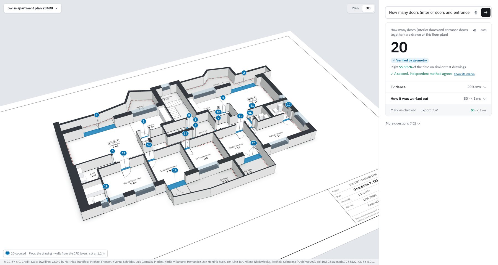
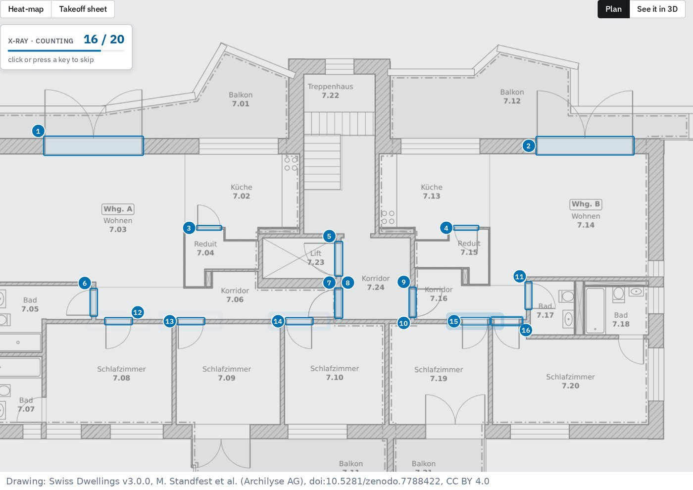
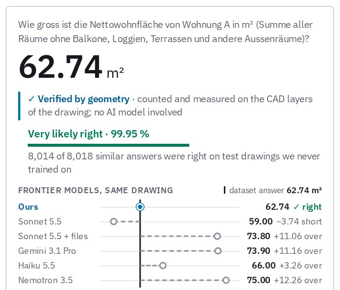
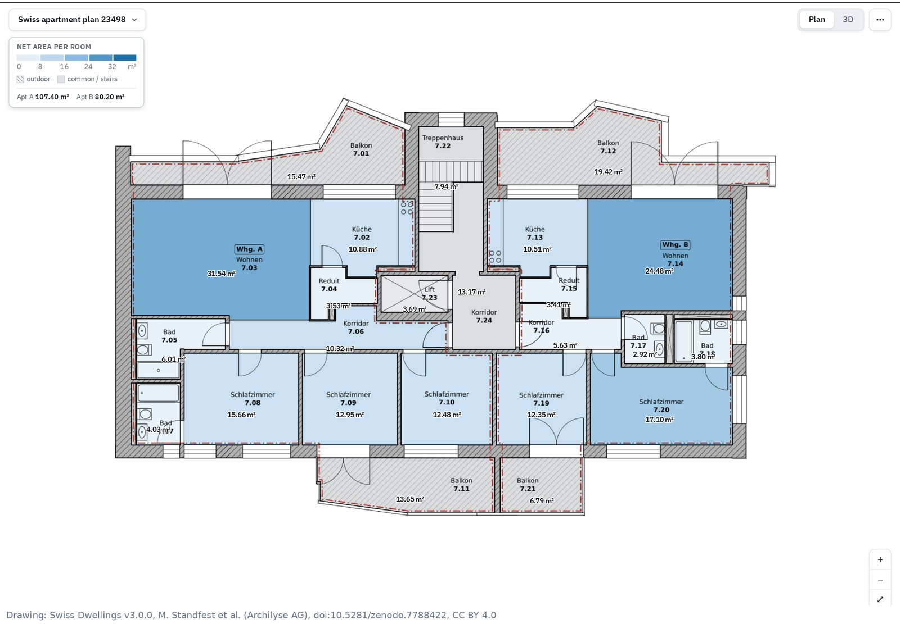
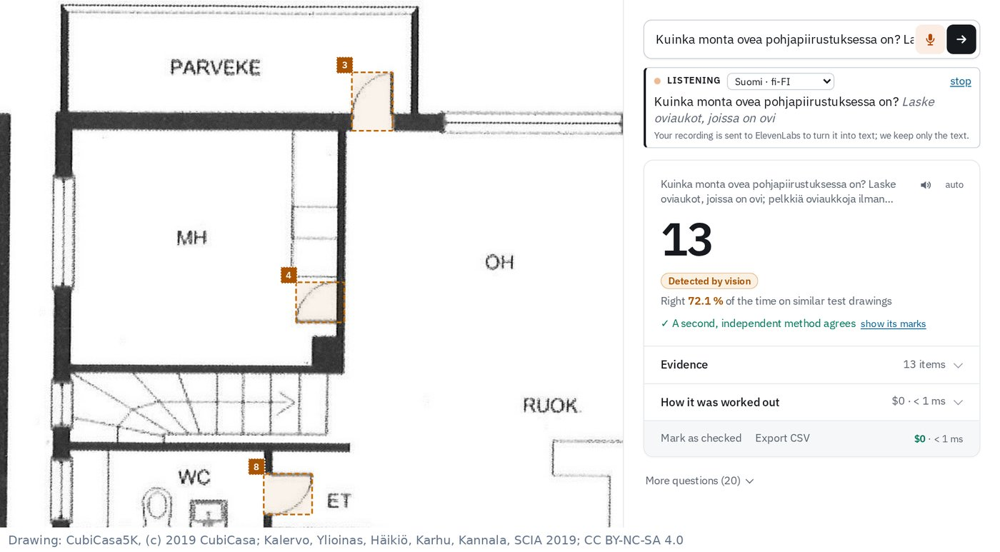
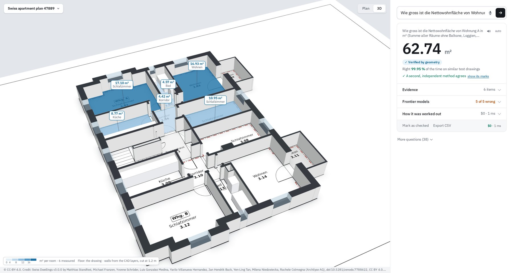
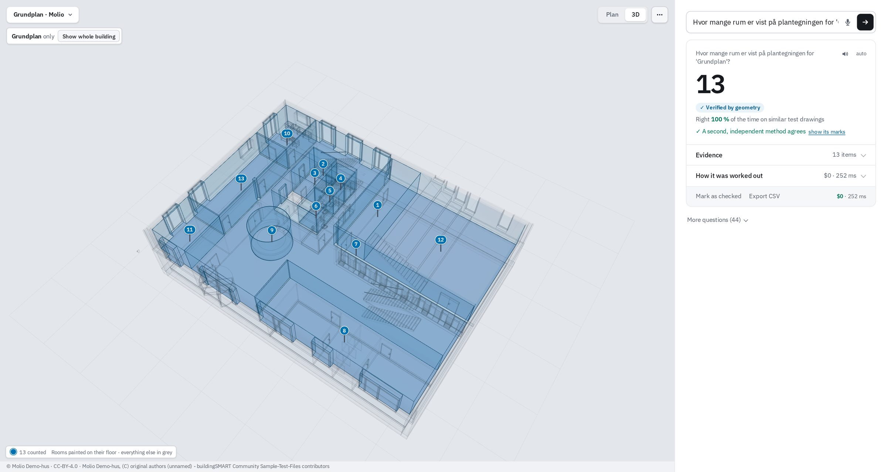
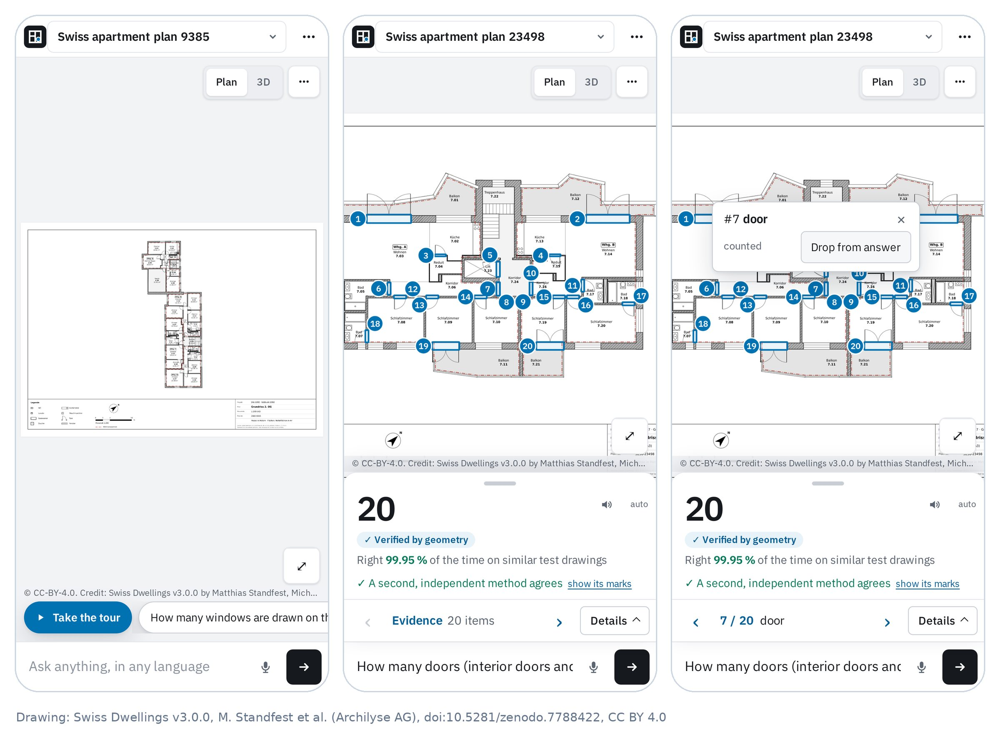
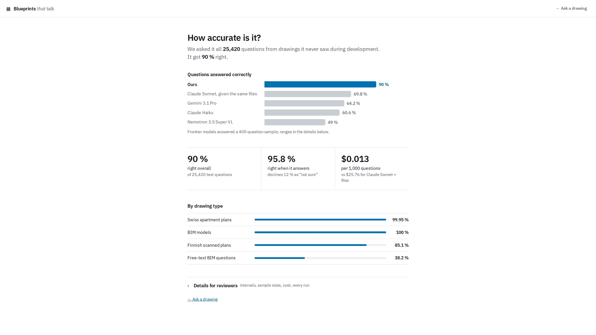

# Datum: blueprints that talk

**▶ [Try the live demo](https://datum.toivo.dev)** (no login) · **[Watch the 2-min video](https://youtu.be/0lAc7Zl9Shg)** · **[Pitch deck (PDF)](docs/deck/deck.pdf)**

[](https://github.com/Zawaer/datum/actions/workflows/ci.yml)

**Ask a construction drawing or a BIM model a question (tested in English, Finnish, German, French, Italian and
Dutch) and get the answer with its proof drawn on the drawing.** Our Junction 2026 entry for Stoa's *Make Blueprints Talk* challenge.
On a drawing, the *datum* is the fixed reference point every measurement is taken from; every Datum answer
traces back to the drawing.

On **all 25,420 questions of a held-out test split** (every question in every language, not a sample) we are right **90.7 %** of the time
[95 % CI 90.4–91.1], for **$0.013 per 1,000 questions** in API fees (+ ~$0.009 local compute) and 0.06 s per question.
The fair frontier comparison, **Claude Sonnet 5.5 given the drawing *and* its sibling CAD / IFC files** (the
same inputs our solvers read), gets **69.8 %** [60.9–78.4] at **$25.76 per 1,000**. That is +21 points at
about 1/1,900 of the cost. The evaluation was **cross-audited by a second AI agent (Codex, OpenAI)**,
and every finding was re-checked: no leakage between dev and test, no test data in
training, tuning or calibration, no gold lookups at inference, and the headline recount reproduces.
**When it answers only at confidence ≥ 0.5, it answers 88.3 % of those questions and is right 95.8 % of the time**;
otherwise it says "not sure" instead of guessing.

A router sends every question to the cheapest method that can answer it **exactly**: CAD geometry for
vector plans, IfcOpenShell for BIM models, a small symbol detector for raster scans. Every answer comes with
its evidence. The doors it counted are numbered on the plan, the rooms it summed are outlined with their m²,
the walls it measured light up in 3D. You can check a number in seconds, and fix it with a click when it's
wrong. Four verification layers sit on top (below): **evidence that adds up**, **calibrated confidence**, an
**independent cross-check** by a second method, and **provenance** checks on every LLM-written number.

Stoa's brief asks for approaches next year's frontier models won't make obsolete: *"hybrids of frontier models
+ CV + 3D/geometry + small fine-tuned models"*. That is this system, piece by piece: CAD and IFC geometry,
our own CV detector (trained on a local RTX 4070), our fine-tuned 8B VLM as second opinion, and Claude Haiku 5.5,
a small frontier LLM, only for free text. Share of the 25,420 test questions per route: CAD / IFC geometry 34.7 %,
detector 64.9 %, Haiku 0.4 % (the 110 free-text questions).

Uploaded construction sheets (floor plans, slab plans, piping plans, as vector PDFs, images or scans) go to
sheet specialists that read the sheet's own text and lines: 41 of 41 right on Stoa's example sheets (public sheets we developed on) as vector
PDFs and full-resolution images, 39 from scans and 2,500 px images, 38 from small 2,000 px screenshots ([complex construction sheets](#complex-construction-sheets)).


<sub>Drawing: Swiss Dwellings v3.0.0, Archilyse AG, CC BY 4.0 (rendered by the Junction dataset authors).</sub>

- **Demo:** [datum.toivo.dev](https://datum.toivo.dev) (rate-limited) &nbsp;·&nbsp; **Video (2 min):** https://youtu.be/0lAc7Zl9Shg &nbsp;·&nbsp; **Deck:** [docs/deck/deck.pdf](docs/deck/deck.pdf)
- **Full results** (every table, figure and CI): [docs/RESULTS.md](docs/RESULTS.md) &nbsp;·&nbsp; **Costs:** [docs/COSTS.md](docs/COSTS.md)

## What you can do in the demo

| | |
|---|---|
|  |  |
| **X-ray count.** The drawing fades back and each door lights up as the number ticks up, so you watch the count happen instead of trusting a total. | **Side by side with frontier models.** Our number next to what five frontier models answered on the same drawing, and how far each one is off. |
|  |  |
| **Heat-map and takeoff sheet.** Every room shaded by its area, and a printable room schedule with door, window and fixture counts, ready to check and sign off. | **Ask by voice.** Press the mic and say the question in the language spoken on site; it is turned into text and asked straight away. |
|  |  |
| **The answer painted in 3D.** The 2D plan tilts up into a low cut-away model; measured rooms are painted on the floor with their m², counted symbols get a numbered pin. A click on a pin opens its card. | **BIM models, floor first.** An IFC model opens on the storey the question is about, with the rooms painted on their floor and a pin on each counted element. |
|  |  |
| **On a phone.** The drawing comes first, the ask bar sits at the bottom, the answer is a bottom sheet; tap a pin (or step through them) for its card. | **Accuracy page.** One chart against the frontier models, three facts, accuracy by drawing type, and every other number one click away. |

Also: **See it in 3D** (top image) tilts a Swiss plan up into a cut-away model with the counted doors painted and pinned
([how it tilts](docs/deck/img/feat-3d-rise.jpg)), and the
**How it works** page (`/how`) walks through routing, the proof on the drawing, the four checks and the cost.
<sub>Drawings: Swiss Dwellings v3.0.0, Archilyse AG, CC BY 4.0 (X-ray, heat-map, 3D, phone); CubiCasa5K, © 2019 CubiCasa, CC BY-NC-SA 4.0 (voice); Molio Demo-hus, buildingSMART Community Sample-Test-Files, CC BY 4.0 (BIM). Each image shows its credit line.</sub>

## Complex construction sheets

Stoa's final judging uploads unseen, complex sheets through the interface, and the brief names what to ask of
them: floor areas, baseboard linear metres, door and window counts, slab area by type (thickness and bars), and,
as a stretch, piping plans. Each upload is classified once from its title block (floor plan, slab plan, piping
plan, other), and a question on it goes to a specialist in [`bp/sheets/`](bp/sheets/) that reads the sheet's own
text and linework. A vector PDF gives the exact words and lines; a scan or a small image goes through local OCR
(Tesseract), with Claude Haiku reading only what OCR cannot. When a specialist is unsure it says so, or hands the
question to the generic reader.

| sheet | specialist | answers |
|---|---|---|
| floor plan | [`arch.py`](bp/sheets/arch.py) dispatches by question | |
| | [`openings.py`](bp/sheets/openings.py) | door and window counts: door swings and glazing strips found by classical CV, checked against the door schedule on a PDF set; on low-res images our CubiCasa detector, cross-checked by a Haiku count |
| | [`zones.py`](bp/sheets/zones.py) | areas and counts from the sheet's schedule tables, colour-coded zones measured against the legend |
| | [`rooms.py`](bp/sheets/rooms.py) | room areas and baseboard (skirting) metres: walls traced, rooms labelled by their names, doorway widths deducted |
| slab plan | [`slab.py`](bp/sheets/slab.py) | slab area by type (thickness + bars), reinforcement, trench lengths, sumps, control-joint panels; metric and imperial |
| piping plan | [`piping.py`](bp/sheets/piping.py), [`pipe_runs.py`](bp/sheets/pipe_runs.py) | tag counts by family, pipe sizes, notes, referenced sheets; run lengths by size, traced from the double-line pipes |

The evidence follows the answer: table cells outlined ("from the sheet's table"), measured lines drawn with
their length, zones filled with a legend of m² per category, tags as chips grouped by family, and a chip that
says how the sheet was read ("Slab plan · measured at 1:50"). A replay works the answer out on the drawing in
2 to 4 seconds: the scale reference first, then the rooms, pins, runs or cells one by one while a running total
ticks up.

**Measured on Stoa's example sheets** (41 questions on the four sheets; gold is the printed value, or our own
measurement where the sheet does not print one, scored with a wider tolerance), uploaded through the real API in
every form a judge might use ([`analysis/stoa_examples_eval.py`](analysis/stoa_examples_eval.py),
[`runs/stoa_examples_v10_forms.summary.md`](runs/stoa_examples_v10_forms.summary.md), the overnight v10 run; 237 of 246
across all six forms):

| upload form | right | dormitory floor plan | school floor plan | slab plan | piping plan |
|---|---:|---:|---:|---:|---:|
| vector PDF page | **41/41** | 8/8 | 8/8 | 12/12 | 13/13 |
| full-resolution PNG | **41/41** | 8/8 | 8/8 | 12/12 | 13/13 |
| 2,500 px PNG | 39/41 | 8/8 | 8/8 | 12/12 | 11/13 |
| simulated scan (150 dpi, skewed, noisy, in a PDF) | 39/41 | 8/8 | 8/8 | 12/12 | 11/13 |
| rough scan (200 dpi on grey paper, rotated, blurred, hand markings) | 39/41 | 8/8 | 8/8 | 12/12 | 11/13 |
| 2,000 px JPG (screenshot size) | 38/41 | 8/8 | 7/8 | 12/12 | 11/13 |

The school plan's door gold is 114, not 128: closet doors are excluded, per Stoa's rule (the viewer shows them
unticked). Before the specialists, the generic reader got 22, 18, 15, 17 and 18 of the original 34 questions on the
vector PDF, full-resolution PNG, 2,000 px JPG, 2,500 px PNG and scan
([`runs/stoa_examples_baseline_forms.summary.md`](runs/stoa_examples_baseline_forms.summary.md)). On 11 questions about sibling sheets from the same public drawing sets, never used while
building, the full-resolution v8 run gets 9 (it misses a first-floor common-area total and the radial bar size on a
tank slab). API cost for all 41 questions: $0.003 on the vector PDFs, $0.09 to $0.20 on the images and scans.

**Where it is weak.** Piping label counts on scans: pipe-support and pressure-gauge counts come out one or two off
on scans and smaller images (42 or 43 supports for 41, 20 or 22 gauges for 21), and the 2,000 px JPG reads 46
supports. Room baseboards on coarse scans come out low, because gaps for windows in the wall are treated as
doorways and deducted. And an occasional slab-area miss when a rough scan merges two rooms into one. Slab areas on unseen sheets: on the held-out imperial slab plan S-100A the areas
come out 23 to 41 % low, and the answer says it is unsure. On a harder set of 41 questions written the way a
site engineer would ask them (13 sheets, Finnish / English / German / Swedish, 5 that must be declined), the
overnight run got 208 of 246 answers right across six upload forms, and 139 of 164 on the four scan and image forms,
up from 89 in the afternoon run `judge_scan_1739`
([`runs/judge_overnight.summary.md`](runs/judge_overnight.summary.md)); most remaining misses are room-level baseboard
and tiling totals, and room and slab questions on the rough scan. The example sheets are public US government and UK OGL drawings; they are
not stored in this repository ([docs/research/EXAMPLE-SOURCES.md](docs/research/EXAMPLE-SOURCES.md)).

## Results

Held-out test split of the full Junction dataset, **split by whole drawing**: each drawing goes to test or dev by a
SHA-1 hash of its id (20 % test, [`bp/data.py`](bp/data.py) `split_of`), so every format of a drawing (PDF, PNG,
DXF, IFC and the plans rendered from it) and every language twin of a question stay on the same side, and nothing
used in development (training, thresholds, prompts) is scored. The cross-audit by a second AI agent (Codex) found 0 leaking groups. Official
tolerance: counts exact, areas / lengths / volumes within 2 %. An abstention counts as wrong.

| system | accuracy [95 % CI] | API $ / 1,000 questions | s / question |
|---|---:|---:|---:|
| **Datum** (all 25,420 questions) | **90.7 %** [90.4–91.1] | **$0.013** | **0.06** |
| Claude Sonnet 5.5 + sibling CAD / IFC files¹ (fair comparison) | 69.8 % [60.9–78.4] | $25.76 | 15.7 |
| Claude Sonnet 5.5, drawing only¹ | 63.2 % [54.4–71.8] | $13.06 | 12.9 |
| Claude Haiku 5.5, drawing only¹ | 60.6 % [51.5–69.3] | $1.21 | 28.6 |
| Gemini 3.1 Pro, drawing only¹ | 64.2 % [55.9–72.3] | $52.47 | 31.4 |
| Nemotron 3.5 Super VL (open weights), drawing only¹ | 49.0 % [40.0–58.0] | $2.59 | 40.1 |
| Most common answer per question template (no drawing) | 41.6 % [41.0–42.2] | $0 | 0 |

**By source (ours).** "Answer everything" is the headline above (a "not sure" counts as wrong). The app also
says how far to trust each answer; if you only accept answers with confidence ≥ 0.5, this is what you get:

| family | test questions | answer everything | accuracy when answered (≥ 0.5) | declines |
|---|---:|---:|---:|---:|
| Swiss apartment plans: counts | 5,580 | 99.96 % | 99.96 % | 0 % |
| Swiss apartment plans: room areas | 2,634 | 99.92 % | 99.92 % | 0 % |
| IFC models: counts, areas, volumes, lengths | 600 | 100 % | 100 % | 0 % |
| Finnish raster plans (CubiCasa, YOLO11m detector + VLM arbiter) | 16,496 | 86.1 % | 93.5 % | 18.0 % |
| IFC-Bench free text (LLM judge; our weakest area) | 110 | 38.2 % | 41.1 % | 13.6 % |
| **all** | **25,420** | **90.7 %** | **95.8 %** | **11.7 %** |

Stricter thresholds trade coverage for accuracy: on the Finnish plans, answering the most confident half (50.0 %)
is 97.4 % right. On the same 400 sampled questions, Sonnet with sibling files is right on 3 that we miss; we are
right on 57 that it misses. Per-source tables for every system: [docs/RESULTS.md](docs/RESULTS.md) §2; coverage
curves: §3.

¹ **Frontier numbers come from a 400-question sample of the test split, stratified by source × type**
(~54 per cell, so each cell is ±~13 pp), **re-weighted to the true test-split mix**, CI from a stratified bootstrap. Cost is the API list
price of the tokens used, re-weighted the same way. Calls that failed on a usage limit were re-run, so every baseline row is a real
answer. Gemini cannot
take a raw `.ifc` file inline, so the 61 sampled questions that come as an `.ifc` file (IFC-Bench text and some
IFC counts) abstain and count as wrong, by design; they are 0.5 % of the test mix after re-weighting.

Sources: ours = [`runs/router_full_test_v8.summary.md`](runs/router_full_test_v8.summary.md) (was 88.2 % in v4; the
+1.3 points to v5 are the new CubiCasa detector, 82.2 % → 84.2 %; v6 adds the richer IFC fact sheet, free text 36.4 % → 38.2 %;
v7 (89.5 % → 90.0 %) adds flip test-time augmentation to the detector, 84.2 % → 85.1 %, chosen on dev only; v8 (90.0 % →
90.7 %) adds the VLM arbiter, 85.10 % → 86.15 %, its per-template rule fit on dev-val only); frontier =
`runs/baseline_{sonnetfair,sonnet,haiku,gemini,nemotron}_full400.jsonl`; all tables rebuilt by
`analysis/run_all.sh` into [docs/RESULTS.md](docs/RESULTS.md) and `analysis/out/*.csv`.

## How we verify

Judges, reviewers and users should not have to take our word for any number. Four verification layers,
plus a cross-audit of the whole evaluation by a second AI agent and a robustness suite:

1. **Evidence that adds up.** Every solver returns `{answer, confidence, method, cost_usd, explanation,
   evidence[]}`. Evidence items are numbered boxes, measured room polygons with their m², text read from the
   drawing, or IFC GlobalIds with their own quantity, in page coordinates normalised to 0..1. **The values of the
   evidence items add up to the answer**, so a reviewer checks the arithmetic, not just a picture, and unticking
   an item or adding a missed one recomputes the answer on the spot ([`docs/EVIDENCE.md`](docs/EVIDENCE.md)).
   We measured that the boxes are right, not just the totals ([`docs/EVIDENCE_QUALITY.md`](docs/EVIDENCE_QUALITY.md)):
   against independent gold instances, CubiCasa boxes reach over 90 % precision and recall (box centres matched; 91 % / 87 % at
   IoU ≥ 0.5), and only about 2.8 % of correct counts are right by luck (a missed object and a false box cancelling out).
2. **Calibrated confidence.** Measured on the test split, not asserted ([RESULTS.md](docs/RESULTS.md) §3,
   fig. 3; the demo states it per answer from [`app/calibration.json`](app/calibration.json)). Raster-plan
   answers at confidence ≥ 0.95 are right 98.7 % of the time. If the router answers only at confidence ≥ 0.5 and
   says "not sure" otherwise, it answers 88.3 % of all questions at 95.8 % accuracy, turning 1,421 wrong answers
   into honest abstentions. Known weak spot: a symbol the detector misses entirely cannot lower its confidence.
3. **Independent cross-check.** A second, independent method re-derives the answer
   ([`runs/crosscheck_test.summary.md`](runs/crosscheck_test.summary.md), `bp/crosscheck.py`): Swiss answers are
   re-read from the PDF alone (text layer, fill polygons × printed scale, vector symbols), IFC answers from the
   plan sheet's SVG, CubiCasa answers by a separately trained second detector. Where they **agree, the answer was
   right on 99.98 % of Swiss and IFC test questions** (all but 2 of 8,184: one washbasin count, asked in two
   languages, where a symbol missing from the drawing fools both readings); the check caught a real Swiss error (an apartment area
   read as 86.72 m² from the DXF, 95.38 m² from the PDF, gold 95.36). On a conflict the answer is kept but its
   confidence is halved and both sets of marks are shown, never silently swapped. On CubiCasa the two detectors
   share training data, so that check is weaker (90.7 % right on agree vs 47.8 % on conflict, measured with the
   previous primary detector). So on raster plans the second opinion is now the fine-tuned Qwen3-VL-8B, a
   different model family: on all 16,496 CubiCasa test questions it agrees with the detector alone on 73.8 %, and
   there the detector is right **94.9 %** (57.3 % on conflict, where the VLM itself is right only 18.6 %, so it
   does not override wholesale; [`runs/crosscheck_vlm_test_v7.summary.md`](runs/crosscheck_vlm_test_v7.summary.md)).
   It does arbitrate narrowly: where they disagree and a per-template rule fit on dev-val says the detector is
   unsure and the VLM sure, the VLM's answer is taken, with the Wilson 95 % lower bound of the rule's dev precision
   (capped at 0.97) as its confidence (CubiCasa 85.10 % → 86.15 %, +1.05 pp, 95 % CI +0.75 to
   +1.38 over drawings; [`runs/cubicasa_test_vlmarb.summary.md`](runs/cubicasa_test_vlmarb.summary.md)). On the
   shipped pipeline, with the confidence halved on the remaining conflicts, the router answers 69.9 % of raster
   questions at 96.3 % ([`runs/crosscheck_vlm_test_v8.summary.md`](runs/crosscheck_vlm_test_v8.summary.md)). The
   demo serves the VLM's precomputed answers and boxes.
4. **Provenance of LLM-written numbers.** Free-text answers are the least verifiable part, so
   `bp/provenance.py` traces every number and quoted name in an LLM answer to the fact lines it cited (sums,
   counts and group totals of cited lines included) and flags the answer when they don't match
   ([`docs/PROVENANCE.md`](docs/PROVENANCE.md)): 97 % of 4,328 claims on test trace; verified answers are
   judge-correct more often than the rest (63 % vs 52 % on dev, 28 % for unverified ones; 42 % vs 39 % on test,
   where only 1 is unverified), so the flag is shown, not hidden.

**Robustness** ([`docs/ROBUSTNESS.md`](docs/ROBUSTNESS.md)): the 12,654 language-twin pairs (same question in
English and Finnish / German / ...) agree 99.4 % (the 72 that differ are raster plans where the VLM arbiter, whose
precomputed answers were made per question text, overrode the detector in one language only); typed paraphrases go through a question normaliser (one cheap
Haiku call, only for questions no parser understands, constrained to names that exist in the drawing) and score
84.6 % vs 57.7 % before it (originals 86.6 %; on a held-out set of 122 paraphrases written after the code:
80.3 % vs 49.2 % before, originals 82.8 %); on 65 questions typed the way a user would (casual, typos, square feet,
"doors and windows", Swedish / Spanish, out-of-scope) 49 are right, all 10 out-of-scope ones decline, and 1 is a
wrong refusal; 49 of 50 must-abstain questions (unknown storeys, nonsense) abstain (the one change: "how many
elevators?" now reads as rooms labelled 'Ascenseur' and answers 2, showing that reading).

**Cross-audit of the whole evaluation by a second AI agent.** Codex (OpenAI) audited the repository read-only; a Claude
agent re-verified every finding against the data. Confirmed: no split leakage (5,884 drawing groups, 0
straddle dev and test), no test data in training, tuning or calibration (`train/cubicasa/make_yolo.py` and
`train/vlm/build_dataset.py` drop test drawings before reading anything), no gold lookups at inference, and
the headline recount reproduces (88.1 % rules-only, 88.2 % with the free-text judge on v4; Sonnet 63.2 %).
Fixed after the audit: the frontier baseline now also gets the sibling files (`claude@sonnet+twins`), and
cached LLM answers report their real cost.

Free-text answers are scored by an LLM judge with a fixed rubric (`bp/judge.py`, validated against hand
labels) for **every** system alike, ours and the baselines.

## Costs

**$0.013 per 1,000 questions** in API fees, measured on all 25,420 test questions: numeric answers make no
paid calls at all; only the 110 free-text IFC questions call Claude Haiku. In the demo, typed questions that
no parser understands add one cached Haiku call for the normaliser (~$0.0003-0.003). Local compute (CAD / IFC parsing on
CPU, the detector on one GPU, ~0.19 s per drawing with flip test-time augmentation; the VLM arbiter only looks up precomputed answers) prices at about $0.009 per 1,000 questions at $0.50 per
GPU-hour. Building everything (frontier baselines, fine-tuning runs, development calls, demo hosting) cost
about $217 one-off so far (including Saturday's live-model GPU window and the 2 × H100 detector / arbiter sweep, ≈ $31; the demo server, still running at the time of writing, is costed up to now). Per-answer and build costs, with every line item: [docs/COSTS.md](docs/COSTS.md)
(`.venv/bin/python analysis/costs.py` regenerates it).

## How it works

```
question + drawing ──► router (by source / file kind; type from multilingual keywords)
                         ├─ Swiss PDF/PNG ──► DXF twin: exact geometry by CAD layer        (bp/solvers/swiss.py)
                         ├─ IFC / plan rendered from IFC ──► IfcOpenShell tables          (bp/solvers/ifc.py)
                         ├─ raster plan (PNG/JPG) ──► YOLO11m symbol detector              (bp/solvers/cubicasa.py)
                         ├─ IFC free text ──► fact sheet with ids + cheap LLM that cites ids (bp/solvers/ifctext.py)
                         ├─ uploaded sheet (floor / slab / piping) ──► sheet specialist     (bp/sheets/)
                         └─ anything else / uploads ──► generic grounded fallback           (bp/solvers/generic.py)
answer ──► second method re-derives it: agree / conflict / single                  (bp/crosscheck.py)
           (PDF re-read for Swiss, SVG sheet for IFC, 2nd detector + fine-tuned VLM for raster)
answer + confidence + evidence + cross-check ──► web app: numbered boxes / room polygons on the plan, elements lit in 3D
```

- **Router** ([`bp/router.py`](bp/router.py)). Picks the solver from the source and file kind; guesses the
  question type from keywords in English, Finnish, German, French, Italian, Danish, Estonian, Swedish, Dutch,
  Polish. Free wording that no parser understands ("how many WC bowls are there?") goes through the question
  normaliser ([`bp/normalize.py`](bp/normalize.py)): one Haiku call rewrites it into a supported template using
  only names that exist in this drawing, or declines; the app shows "read as: ...". A crashing or unsure solver abstains ("not sure") rather than guessing; a frontier fallback exists
  but is off by default.
- **Swiss Dwellings: CAD geometry** ([`bp/solvers/swiss.py`](bp/solvers/swiss.py), [`bp/swiss/parse.py`](bp/swiss/parse.py)).
  Questions are asked about the PDF; the dataset ships the same drawing as DXF, so we read doors, windows,
  sanitary fixtures, room outlines and apartment boundaries from the CAD layers with ezdxf and Shapely, and
  map the evidence back onto the PDF page through the room numbers both files share. No model call.
- **IFC models: IfcOpenShell** ([`bp/solvers/ifc.py`](bp/solvers/ifc.py), [`bp/ifc/`](bp/ifc/)). Counts, net
  areas, wall lengths and volumes from quantity sets and geometry, per storey. Questions about plan PDFs
  rendered from a model are answered from the model itself. Evidence = the GlobalId of every contributing
  element with its own value, highlighted in 3D (three.js) and on the plan.
- **Raster plans: detector** ([`bp/solvers/cubicasa.py`](bp/solvers/cubicasa.py), [`train/cubicasa/`](train/cubicasa/README.md)).
  One YOLO11m detector (v4, 85.1 % on all 16,496 test counts with flip test-time augmentation: four flips merged by weighted box fusion, thresholds tuned on dev; 84.2 % without, 82.2 % with YOLO11s; 86.15 % with the VLM arbiter below), trained on the public CubiCasa5K annotations of non-test drawings only, finds windows,
  doors, toilets, sinks, showers, bathtubs, sauna stoves and typed rooms. The question template picks the
  classes; each counted detection is a numbered box with its own score, and the confidence is calibrated on
  dev drawings. Trained on a local RTX 4070.
- **Fine-tuned small VLM, second opinion** ([`bp/solvers/vlm.py`](bp/solvers/vlm.py), [`train/vlm/`](train/vlm/)).
  Qwen3-VL-8B + LoRA, trained on cloud H100s (Verda) on dev-split drawings only, answers with one box per
  counted item, so the count always equals the boxes. Round 3 scores 73.0 % on a 1,000-question test sample
  (round 2: 64.4 %; [`runs/vlm_q3vl8b_r3c2200_test1000.summary.md`](runs/vlm_q3vl8b_r3c2200_test1000.summary.md)),
  below the detector and the CAD path, so it does not answer on its own: it is the cross-check's second
  opinion on raster plans and a narrow arbiter (taken only where the detector is unsure and the VLM sure, per a
  per-template rule fit on dev-val; CubiCasa 85.10 % → 86.15 %). On all 16,496 CubiCasa test questions it scores
  74.9 % alone (detector 85.1 %), agrees with the detector on 73.8 %, and where it agrees the detector is right 94.9 %
  ([`runs/vlm_r3_cubicasa_test_full.summary.md`](runs/vlm_r3_cubicasa_test_full.summary.md),
  [`runs/crosscheck_vlm_test_v7.summary.md`](runs/crosscheck_vlm_test_v7.summary.md), [`runs/cubicasa_test_vlmarb.summary.md`](runs/cubicasa_test_vlmarb.summary.md)); $0.16 per 1,000 questions on
  one H100. A PaliGemma 2 fine-tune was weaker (52 % on dev) and is not shipped.
- **Generic grounded fallback** ([`bp/solvers/generic.py`](bp/solvers/generic.py)). For uploads and other
  sources: the text layer of vector PDFs / DXF is split into segments with ids and an LLM must answer *by
  citing ids*, so sums are recomputed from what it cited; without a text layer, a vision model boxes every
  instance, tile by tile. On the 64 opening_design questions (no held-out split, so indicative) it answers
  93.8 % at $4.85 / 1,000 ([`generic_opening_final`](runs/generic_opening_final.summary.md); an earlier run of the same setup scored 92.2 %).
- **Free text about IFC** ([`bp/solvers/ifctext.py`](bp/solvers/ifctext.py), [`bp/judge.py`](bp/judge.py)).
  A fact sheet is extracted from the model, each line with an id that maps back to GlobalIds; rules answer the
  common question shapes and a cheap LLM answers the rest citing those ids. Free text is our weakest area
  (38.2 %), and we say so.

## Run it

Tested with Python 3.11 on Linux with an NVIDIA GPU (the detector also runs on CPU, slower). Run everything
from the repository root.

```bash
python3 -m venv .venv && . .venv/bin/activate
pip install -r requirements.txt                 # ~8 min, ~6.5 GB (torch with CUDA from PyPI)
playwright install chromium                     # only for screenshots / the video / the deck

# dataset (10 GB, non-commercial, not redistributed here)
mkdir -p data/full && cd data/full
curl -LO https://fwjydgxpttajiqpfmqtj.supabase.co/storage/v1/object/public/stoa-junction-2026/junction-dataset.zip
unzip -q junction-dataset.zip && cd ../..       # -> data/full/junction-dataset/questions.jsonl (or set BP_DATA)

# CubiCasa detector weights: not in git. Train them with train/cubicasa/README.md (5.5 GB download, 1-2 h per
# run on an RTX 4070; ~5 GPU-h across all our iterations) -> cache/cubicasa/weights/{best.pt,thresholds.json,calib.json}

# demo app
.venv/bin/python -m uvicorn app.server:app --host 0.0.0.0 --port 3123    # http://localhost:3123
```

**Without the detector weights**, Swiss and IFC questions work fully, but every raster-plan (CubiCasa)
question abstains with "cubicasa solver failed: FileNotFoundError", which is 16,496 of the 25,420 test
questions. Point `CUBICASA_WEIGHTS` at a `best.pt` if yours is elsewhere.

The app has a guided demo tour (`app/tour.json`), drawing upload (PDF, PNG, JPG, DXF, IFC; sheet specialists need
`tesseract` on `PATH` for images and scans), and a scoreboard
page that reads `runs/*.summary.md`.

**API keys.** Every numeric answer (counts, areas, lengths, volumes) needs no key and no network. Only these
call a model:

| feature | needs |
|---|---|
| IFC free-text answers, the typed-question normaliser, the `--judge` scorer, `claude@*` baselines | the Claude Code CLI (`npm install -g @anthropic-ai/claude-code`) on `PATH` (`claude`, logged in or with `ANTHROPIC_API_KEY`), or `CLAUDE_CLI=/path/to/claude` |
| `gemini` baseline | `GEMINI_API_KEY` |
| `nemotron` baseline | `NVIDIA_API_KEY` |

Without the CLI nothing crashes: free-text IFC questions fall back to the rule-based fact-sheet answer
(after ~12 s of retries per question), and a typed question no parser understands gets "question not
understood" plus the labels the drawing does have.

## Reproduce every number

**Tests** (~5 s, no dataset, weights or keys; `.github/workflows/ci.yml` runs the same): `pip install -r requirements-dev.txt && pytest -m "not data"` (plain `pytest` also runs the end-to-end checks on real drawings when `data/` and the CubiCasa weights are present).

Each command writes `runs/<name>.jsonl` (one row per question: prediction, gold, correct, cost, latency,
evidence) and `runs/<name>.summary.md` (tables by type, source, source × type, language). The `--sample` is
deterministic (hash of path + question), and `--ids-from` re-runs exactly the questions of another run, so
every baseline answers the same 400 questions.

**Quick check without keys** (~6 min on an RTX 4070 + 8 CPU threads, $0):

```bash
python eval.py --solver router --split test --jobs 8 --name router_check     # all 25,420, no --judge
```

This scores free text with a token-F1 proxy instead of the LLM judge, so expect 90.7 % (ifc_bench text
34.5 % instead of 38.2 %; every other cell as in [`runs/router_full_test_v8.summary.md`](runs/router_full_test_v8.summary.md)).
The VLM arbiter needs the precomputed VLM answers (`runs/vlm_r3_cubicasa_test_full.jsonl`); without them the raster
rows fall back to the detector alone (85.1 %).
Do not pass `--judge` without the Claude CLI: a failed judge call scores the answer as wrong. A
`--sample N` run is stratified by source × type, not weighted to the test mix, so compare its
per-source rows, not its "ALL" row, with the headline.

The full set (the baselines need the keys above):

```bash
python eval.py --solver router --split test --jobs 8 --judge --name router_full_test_v8      # 90.7 %, all 25,420
python eval.py --solver claude@sonnet --split test --sample 400 --jobs 6 --name baseline_sonnet_full400
S=runs/baseline_sonnet_full400.jsonl
python eval.py --solver claude@sonnet+twins --split test --ids-from $S --jobs 6 --name baseline_sonnetfair_full400
python eval.py --solver claude@haiku  --split test --ids-from $S --jobs 6 --name baseline_haiku_full400
python eval.py --solver gemini        --split test --ids-from $S --jobs 6 --name baseline_gemini_full400
python eval.py --solver nemotron      --split test --ids-from $S --jobs 6 --name baseline_nemotron_full400
python eval.py --solver prior  --split test --name prior_full_test                                   # 41.6 %
python eval.py --solver router --split test --source swiss_dwellings --source ifc_models --source cubicasa5k \
  --crosscheck --name crosscheck_test                                                         # cross-check
.venv/bin/python analysis/crosscheck_vlm_report.py runs/router_full_test_v7.jsonl crosscheck_vlm_test_v7 \
  "YOLO11m v4 with flip TTA" > runs/crosscheck_vlm_test_v7.summary.md                        # VLM second opinion
.venv/bin/python analysis/crosscheck_vlm_report.py runs/router_full_test_v8.jsonl crosscheck_vlm_test_v8 \
  "flip-TTA YOLO11m v4 + VLM arbiter, the shipped pipeline" > runs/crosscheck_vlm_test_v8.summary.md
BP_OURS_RUN=router_full_test_v8 bash analysis/run_all.sh   # judge baseline text answers, re-weighting, CIs,
                                                           # figures, docs/RESULTS.md, analysis/out/*.csv
.venv/bin/python analysis/costs.py                          # docs/COSTS.md
```

`analysis/run_all.sh` and `analysis/costs.py` read the per-question `runs/*.jsonl` logs and the spend logs
under `cache/`, which are not in git (only the `runs/*.summary.md` tables are). Run them after the eval
commands above, not on a fresh clone: there, `costs.py` would rewrite `docs/COSTS.md` with $0 rows.

Per-solver checks: `--solver swiss`, `ifc`, `cubicasa`, `ifctext@combo --source ifc_bench --judge`, and
`vlm` (needs a served LoRA, see `train/vlm/README.md`). Rules and thresholds were tuned on the dev split only.

## Data, licences, credits

- **Code:** MIT licence, see [LICENSE](LICENSE) (Junction submissions are MIT-licensed). Dependencies keep
  their own licences (notably Ultralytics YOLO, AGPL-3.0, installed from PyPI, not vendored); see
  [THIRD_PARTY.md](THIRD_PARTY.md). Screenshots that show dataset drawings carry the drawing's licence, not MIT.
- **Dataset:** the Junction 2026 construction drawings dataset by Stoa, **non-commercial use for the challenge,
  per-file licences** in `data/<source>/LICENSE.md`. It is not included in this repository. Drawings shown in
  this README, the deck and the video:
  - Swiss Dwellings v3.0.0, Matthias Standfest, Michael Franzen, Yvonne Schröder, Luis Gonzalez Medina, Yarilo
    Villanueva Hernandez, Jan Hendrik Buck, Yen-Ling Tan, Milena Niedzwiecka, Rachele Colmegna (Archilyse AG),
    [doi:10.5281/zenodo.7788422](https://doi.org/10.5281/zenodo.7788422), CC BY 4.0; plans rendered from the
    published geometry by the dataset authors.
  - CubiCasa5K, © 2019 CubiCasa; Kalervo, Ylioinas, Häikiö, Karhu, Kannala, "CubiCasa5K: A Dataset and an
    Improved Multi-Task Model for Floorplan Image Analysis", SCIA 2019, CC BY-NC-SA 4.0. The detector is trained
    on the public CubiCasa5K annotations ([Zenodo 2613548](https://zenodo.org/records/2613548)).
  - Molio Demo-hus, buildingSMART Community Sample-Test-Files contributors, CC BY 4.0.
  - BIM-Speed Warmond demo site, Garcia & Hartmann 2022, TU Berlin, doi:10.14279/depositonce-16441.2, CC BY 4.0.
  - IFC-Bench v2 questions, © 2025 Sylvain Hellin (TUM), CC BY 4.0.
- **Models:** Ultralytics YOLO11, Qwen3-VL (Apache-2.0), Claude Sonnet 5.5 / Haiku 5.5 (baselines, judge and
  free-text answers), Gemini 3.1 Pro and Nemotron 3.5 Super VL (baselines).

## Team

Toivo and Rene, Junction 2026 (Espoo, 13–15 Nov 2026). Built during the event with Claude Code.

**Challenges entered:** Stoa "Make Blueprints Talk" (main), Verda Compute Track, Best Use of ElevenLabs, Best Use of CRACI. Tools and why each qualifies: [docs/TRACKS.md](docs/TRACKS.md).
