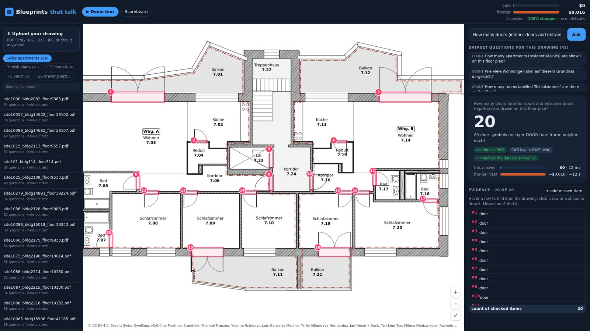

# Blueprints That Talk

**Ask a construction drawing or a BIM model a question, in any language, and get the answer with its proof
drawn on the drawing.** Our Junction 2026 entry for Stoa's *Make Blueprints Talk* challenge.

A router sends every question to the cheapest method that can answer it **exactly**: CAD geometry for
vector plans, IfcOpenShell for BIM models, a small symbol detector for raster scans. Every answer comes with
its evidence: the doors it counted are numbered on the plan, the rooms it summed are outlined with their m²,
the walls it measured light up in 3D. You can check a number in seconds, and fix it with a click when it's
wrong. On the **25,420 questions of our held-out test split** it is right **87.2 %** of the time, at
**$0 per 1,000 questions** and 0.03 s per question. Claude Sonnet 5.5, given the drawing and the question
directly, gets 63.2 % at $13.06 per 1,000.


<sub>Drawing: Swiss Dwellings v3.0.0, Archilyse AG, CC BY 4.0 (rendered by the Junction dataset authors).</sub>

- **Demo:** TODO public URL &nbsp;·&nbsp; **Video (2 min):** TODO link &nbsp;·&nbsp; **Deck:** [docs/deck/deck.pdf](docs/deck/deck.pdf)

## Results

Held-out test split of the full Junction dataset. The split is **by drawing**: every format of a drawing and
every language twin of a question stay on the same side, so nothing used for development is scored. Official
tolerance: counts exact, areas / lengths / volumes within 2 %. An abstention counts as wrong.

| source · question type | n (test) | **ours** | Claude Sonnet 5.5 direct¹ | Claude Haiku 5.5 direct¹ |
|---|---:|---:|---:|---:|
| Swiss apartment plans · counts | 5,580 | **100.0 %** | 79.6 % | 74.1 % |
| Swiss apartment plans · areas | 2,634 | **99.9 %** | 38.9 % | 25.9 % |
| IFC models · counts | 136 | **100.0 %** | 42.6 % | 33.3 % |
| IFC models · room areas | 390 | **100.0 %** | 9.3 % | 7.4 % |
| IFC models · volumes | 52 | **100.0 %** | 3.8 % | 1.9 % |
| IFC models · lengths | 22 | **100.0 %** | 13.6 % | 36.4 % |
| Finnish raster plans (CubiCasa) · counts | 16,496 | **80.8 %** | 63.6 % | 63.6 % |
| IFC-Bench · free text² | 110 | 34.5 % | 1.8 % | 1.8 % |
| **all test questions** | **25,420** | **87.2 %** | **63.2 %**¹ | **60.6 %**¹ |
| **$ per 1,000 questions** | | **$0.00** | **$13.06**¹ | **$1.21**¹ |
| seconds per question | | 0.03 | ~13¹ | ~29¹ |

Sources: ours = [`runs/router_full_test.summary.md`](runs/router_full_test.summary.md) (all 25,420 questions),
confirmed per solver by [`swiss_verify_test`](runs/swiss_verify_test.summary.md),
[`ifc_verify_test`](runs/ifc_verify_test.summary.md) and [`cubicasa_verify_test`](runs/cubicasa_verify_test.summary.md)
(80.7 %, a re-run of the same detector). Frontier: [`baseline_sonnet_full400`](runs/baseline_sonnet_full400.summary.md),
[`baseline_haiku_full400`](runs/baseline_haiku_full400.summary.md).

¹ **Frontier numbers come from a 400-question sample of the test split, stratified by source × type** (about 54
questions per cell, so each cell is roughly ±13 pp), **re-weighted to the true test-split mix** (the n column).
Unweighted, the sample over-represents IFC and scores 33.2 % (Sonnet) and 30.2 % (Haiku). Cost is the API list
price of the tokens used; the model gets the drawing file (PDF / image) plus the question.
² Free-text answers are scored with a token-F1 ≥ 0.5 proxy here (both columns). With an LLM judge, our
fact-sheet + Haiku pipeline scores 27.3 % at $2.78 / 1,000 ([`ifctext_combo_test`](runs/ifctext_combo_test.summary.md)).
Free text is our weakest area, and we say so.

Other reference points: answering with the most common answer for each question template, without looking
at the drawing, scores 41.6 % on the same 25,420 test questions ([`prior_full_test`](runs/prior_full_test.summary.md)).
The generic fallback (text layer + grounded vision, Haiku) answers 92.2 % of the 64 opening_design questions
at $5.02 / 1,000 ([`generic_opening_haiku`](runs/generic_opening_haiku.summary.md); that source has no held-out
split, so read it as indicative).

**Pending:** TODO fine-tuned VLM for raster counting (results not in yet); TODO final CubiCasa detector run
(a larger detector is training; the table shows the current one).

## How it works

```
question + drawing ──► router (by source / file kind; type from multilingual keywords)
                         ├─ Swiss PDF/PNG ──► DXF twin: exact geometry by CAD layer        (bp/solvers/swiss.py)
                         ├─ IFC / plan rendered from IFC ──► IfcOpenShell tables          (bp/solvers/ifc.py)
                         ├─ raster plan (PNG/JPG) ──► YOLO11 symbol detector               (bp/solvers/cubicasa.py)
                         │                         └► fine-tuned small VLM, boxes + count   (bp/solvers/vlm.py, in training)
                         ├─ IFC free text ──► fact sheet with ids + cheap LLM that cites ids (bp/solvers/ifctext.py)
                         └─ anything else / uploads ──► generic grounded fallback           (bp/solvers/generic.py)
answer + confidence + evidence ──► web app: numbered boxes / room polygons on the plan, elements lit in 3D
```

- **Router** ([`bp/router.py`](bp/router.py)). Picks the solver from the source and file kind; guesses the
  question type from keywords in English, Finnish, German, French, Italian, Danish, Estonian, Swedish, Dutch,
  Polish. A crashing or unsure solver abstains ("not sure, so no guess") rather than guessing; a frontier
  fallback exists but is off by default.
- **Swiss Dwellings: CAD geometry** ([`bp/solvers/swiss.py`](bp/solvers/swiss.py), [`bp/swiss/parse.py`](bp/swiss/parse.py)).
  Questions are asked about the PDF; the dataset ships the same drawing as DXF, so we read doors, windows,
  sanitary fixtures, room outlines and apartment boundaries from the CAD layers with ezdxf and Shapely, and
  map the evidence back onto the PDF page through the room numbers both files share. No model call.
- **IFC models: IfcOpenShell** ([`bp/solvers/ifc.py`](bp/solvers/ifc.py), [`bp/ifc/`](bp/ifc/)). Counts, net
  areas, wall lengths and volumes from quantity sets and geometry, per storey. Questions about the plan PDFs
  rendered from a model are answered from the model itself. Evidence = the GlobalId of every contributing
  element with its own value, highlighted in 3D (three.js) and on the plan.
- **Raster plans: detector** ([`bp/solvers/cubicasa.py`](bp/solvers/cubicasa.py), [`train/cubicasa/`](train/cubicasa/README.md)).
  One YOLO11 detector, trained on the public CubiCasa5K SVG annotations of non-test drawings only, finds
  windows, doors, toilets, sinks, showers, bathtubs, sauna stoves and typed rooms. The question template picks
  the classes; each counted detection is a numbered box. Trained on the local RTX 4070.
- **Raster plans: fine-tuned small VLM** ([`bp/solvers/vlm.py`](bp/solvers/vlm.py), [`train/vlm/`](train/vlm/)).
  Qwen3-VL + LoRA, trained on a cloud GPU (Verda) on dev-split drawings only, answers with one box per counted
  item, so the count always equals the boxes. TODO: results pending.
- **Generic grounded fallback** ([`bp/solvers/generic.py`](bp/solvers/generic.py)). For uploads and other
  sources: the text layer of vector PDFs / DXF is split into segments with ids and an LLM must answer *by citing
  ids*, so sums are recomputed from what it cited; without a text layer, a local Qwen3-VL (4-bit, 4B) or a cheap
  API model boxes every instance, tile by tile.
- **Free text about IFC** ([`bp/solvers/ifctext.py`](bp/solvers/ifctext.py), [`bp/judge.py`](bp/judge.py)).
  A fact sheet is extracted from the model, each line with an id that maps back to GlobalIds; a cheap LLM answers
  citing those ids. Text answers are graded either by a token-F1 proxy or by an LLM judge with a fixed rubric,
  validated against hand labels.

### Evidence format

Every solver returns `{answer, confidence, method, cost_usd, explanation, evidence[]}`. Evidence items are
numbered boxes, measured polygons (with their m²), text read from the drawing, or IFC GlobalIds, in page
coordinates normalised to 0..1. **The values of the evidence items add up to the answer**, so a reviewer
checks the arithmetic, not just the picture, and unticking an item or adding a missed one recomputes the
answer on the spot. Full spec: [`docs/EVIDENCE.md`](docs/EVIDENCE.md).

## Run it

```bash
python3 -m venv .venv && . .venv/bin/activate
pip install -r requirements.txt fastapi uvicorn ultralytics torch playwright
playwright install chromium                     # only for screenshots / the video

# dataset (10 GB, non-commercial, not redistributed here)
mkdir -p data/full && cd data/full
curl -LO https://fwjydgxpttajiqpfmqtj.supabase.co/storage/v1/object/public/stoa-junction-2026/junction-dataset.zip
unzip -q junction-dataset.zip && cd ../..       # -> data/full/junction-dataset/questions.jsonl (or set BP_DATA)

# CubiCasa detector weights: see train/cubicasa/README.md (~1 h on an RTX 4070)

# demo app
.venv/bin/python -m uvicorn app.server:app --host 0.0.0.0 --port 3123    # http://localhost:3123
```

The app has a guided demo tour (`app/tour.json`), drawing upload (PDF, PNG, JPG, DXF, IFC), and a scoreboard
page that reads `runs/*.summary.md`. The Claude baselines and the text fallback call Claude through the
Claude Code CLI; the numeric solvers need no API key.

## Reproduce every number

Each command writes `runs/<name>.jsonl` (one row per question: prediction, gold, correct, cost, latency,
evidence) and `runs/<name>.summary.md` (tables by type, source, source × type, language).

```bash
python eval.py --solver router  --split test --jobs 8 --name router_full_test         # 87.2 %, all 25,420
python eval.py --solver swiss   --split test --jobs 8 --name swiss_verify_test
python eval.py --solver ifc     --split test --jobs 8 --name ifc_verify_test
python eval.py --solver cubicasa --split test         --name cubicasa_verify_test
python eval.py --solver claude@sonnet --split test --sample 400 --jobs 6 --name baseline_sonnet_full400
python eval.py --solver claude@haiku  --split test --sample 400 --jobs 6 --name baseline_haiku_full400
python eval.py --solver ifctext@combo --split test --source ifc_bench --judge --name ifctext_combo_test
python eval.py --solver generic@haiku+haiku --split all --source opening_design --name generic_opening_haiku
python eval.py --solver prior   --split test --name prior_full_test                   # 41.6 %
```

Re-weighting the stratified frontier sample to the test mix (accuracy and $/1k): for each source × type
cell, take the sample's cell value from the baseline summary and weight it by that cell's n in
`router_full_test.summary.md`; sum and divide by 25,420. The `--sample` is deterministic (hash of path +
question), so the same 400 questions come back every time.

Rules and thresholds were tuned on the dev split only; the detector and the VLM never saw a test drawing
(`train/cubicasa/make_yolo.py` and `train/vlm/build_dataset.py` drop test drawings before reading anything).

## Data, licences, credits

- **Code:** MIT licence (Junction submissions are MIT-licensed). Dependencies keep their own licences
  (notably Ultralytics YOLO, AGPL-3.0, installed from PyPI, not vendored).
- **Dataset:** the Junction 2026 construction drawings dataset by Stoa, **non-commercial use for the challenge,
  per-file licences** in `data/<source>/LICENSE.md`. It is not included in this repository. Drawings shown in
  this README, the deck and the video:
  - Swiss Dwellings v3.0.0, Matthias Standfest, Michael Franzen, Yvonne Schröder, Luis Gonzalez Medina, Yarilo
    Villanueva Hernandez, Jan Hendrik Buck, Yen-Ling Tan, Milena Niedzwiecka, Rachele Colmegna (Archilyse AG),
    [doi:10.5281/zenodo.7788422](https://doi.org/10.5281/zenodo.7788422), CC BY 4.0; plans rendered from the
    published geometry by the dataset authors.
  - CubiCasa5K, © 2019 CubiCasa; Kalervo, Ylioinas, Häikiö, Karhu, Kannala, "CubiCasa5K: A Dataset and an
    Improved Multi-Task Model for Floorplan Image Analysis", SCIA 2019, CC BY-NC-SA 4.0. The detector is trained
    on the public CubiCasa5K annotations ([Zenodo 2613548](https://zenodo.org/records/2613548)).
  - Molio Demo-hus, buildingSMART Community Sample-Test-Files contributors, CC BY 4.0.
  - IFC-Bench v2 questions, © 2025 Sylvain Hellin (TUM), CC BY 4.0.
- **Models:** Ultralytics YOLO11, Qwen3-VL (Apache-2.0), Claude Sonnet 5.5 / Haiku 5.5 (baselines, judge and
  optional fallback).

## Team

Toivo and Rene, Junction 2026 (Espoo, 13–15 Nov 2026). Built during the event with Claude Code.
