# Design notes: how the demo should look

Who it is for: quantity surveyors, estimators, site and design engineers. Their tools are Bluebeam Revu,
Procore Drawings, Autodesk Construction Cloud and PlanSwift- or Togal-style takeoff software. In all of them
the drawing fills the screen and a measurement list sits beside it. That list is where they check the numbers.
The demo should feel like one more of those tools, a sober one. It should not look like a chat app.

The tokens live at the top of [`app/static/app.css`](../app/static/app.css). The scoreboard,
[`app/static/results.html`](../app/static/results.html), uses the same tokens.

## What the reference tools do

- **Bluebeam Revu** keeps every markup in a *Markups List* next to the sheet. Its columns are Label, Length, Area,
  Volume, Count and Measurement, plus custom formula columns for cost. Clicking a row selects the markup on the
  page, and the list exports to CSV or PDF with the units in their own columns.
  [Markups List](https://support.bluebeam.com/online-help/revu20/Content/RevuHelp/Menus/Window/Panels/Markups/Markups-List--MTV.htm),
  [custom columns for takeoff](https://support.bluebeam.com/user-manual/tutorials/custom-columns-takeoffs.html),
  [Markup summary](https://support.bluebeam.com/no/user-manual/menus/batch/summary.html)
- **Togal.AI** runs an AI takeoff, then puts every result both on the drawing and in a *Quantities Panel* beside
  it. The panel holds a subtotal for each classification and the instances that make it up. Clicking an instance
  highlights it on the drawing, the totals update live as you deduct or add, and a check icon toggles visibility.
  [Quantities panel](https://help.togal.ai/en/articles/15601691-togal-s-quantities-panel),
  [overview](https://help.togal.ai/en/articles/15611909-quantities-panel-overview)
- **Procore and ACC drawings** show a white sheet on a neutral canvas. Markups are coloured strokes on the line
  art, and the controls float on the canvas as small, flat toolbars.

Our app does the same thing with one difference: the AI does the takeoff and the person checks it.

## Principles we apply

1. **The drawing is the hero.** It takes the widest column. The sheet is shown as white paper on a mid-grey canvas
   (`--paper`), so its edge is visible, as in Revu and Procore. The controls on top of it (zoom, Plan/3D, storey)
   are small, white and hairline-bordered, with no shadows or glow.
2. **Light theme with neutral chrome.** Drawings are black line art on white, so the UI around them is
   white and grey too. A dark UI around a white sheet is tiring and gives poor contrast on a projector. The one
   ink-black surface is the demo-tour caption, because it sits on top of the drawing and has to stand apart from it.
3. **One accent, and it means "our evidence".** Blue (`--ev`, Okabe-Ito `#0072B2`) is used for the numbered
   marks, the room outlines, the list numbers, our row in the comparison table, our series in charts and the 3D
   highlight. Buttons and selected tabs are ink-black rather than blue, so the blue is never mistaken for decoration.
   The Swiss plans already carry red dash-dot boundaries, and blue marks stay readable against them where red
   ones did not.
4. **Status colours are colour-blind safe and never the only cue** ([WCAG 1.4.1](https://www.w3.org/WAI/WCAG22/Understanding/use-of-color.html)).
   We use [Okabe-Ito](https://jfly.uni-koeln.de/color/) hues, and each one comes with a second cue:

   | meaning | hue | line style | word / glyph |
   |---|---|---|---|
   | measured from CAD / IFC geometry | blue `#0072B2` | solid | "Verified by geometry", ✓ |
   | read by a model, needs a check | orange `#C26A00` | dashed, with the detector score boxed | "Detected by vision", score % |
   | added by you | bluish green `#009E73` | solid | "added by you" |
   | dropped by you | grey | dotted, struck through in the list | unticked box |
   | conflict / wrong | vermillion `#D55E00` | double rule | "⚠ Conflict", ✗ |
   | second, independent method | reddish purple `#CC79A7` | dotted | "show its marks" |
   | the item you point at | highlighter yellow `#F0E442` | thick ink outline | (hover) |
5. **Contrast.** Body text is 17.6:1 on white and secondary text (`--mut`) is 6.0:1. Every status colour has an
   `*-ink` tone that passes 4.5:1 when used as text ([WCAG 1.4.3](https://www.w3.org/WAI/WCAG22/Understanding/contrast-minimum.html)).
   Strokes and control borders are at least 3:1 ([WCAG 1.4.11](https://www.w3.org/WAI/WCAG22/Understanding/non-text-contrast.html)),
   which matters on a washed-out projector.
6. **Quantities use tabular, lining figures, right-aligned, with the unit attached.** This is how
   [Carbon's data table](https://carbondesignsystem.com/components/data-table/usage/) and
   [Matthew Ström's table guide](https://matthewstrom.com/writing/tables/) say to do it. The body sets
   `font-feature-settings: "tnum"`, so every number lines up. The value column is right-aligned and every value
   carries its unit ("17.10 m²").
7. **The answer can be read in two seconds.** It goes in this order: the question in small text, the quantity in
   large type (44 px) with its unit, one line on how it was found, then one plain-language confidence line
   ("Very likely right · 99.95 %") with the track record under it, then the counting rule. The less important
   parts come after that: sign-off, "why this answer", frontier comparison and cost. The order is set in CSS with
   `order:`, so it holds whatever order the markup arrives in.
8. **The evidence list is a takeoff sheet.** It has a tick box, a running number that matches the badge on the
   drawing, the item and a right-aligned quantity. The total sits under a double rule, as on a bill of quantities.
   Rows are 28 px tall (36 px on touch). Hovering a row highlights its mark and the reverse, as in Revu and Togal.
9. **Words over badges.** Confidence is a sentence with its sample size behind it. We do not show a coloured
   "92 %" chip, and the copy avoids vague AI wording.
10. **A restrained type system.** We use [IBM Plex Sans](https://www.ibm.com/plex/), an engineering grotesque with
    tabular figures, and Plex Mono for formulas and codes. The scale is 11 / 12 / 13 / 14 / 16 / 20 / 28 / 44 px.
    Small labels are uppercase 11 px with letter spacing, and the weights are 400 / 500 / 600.
11. **Flat surfaces.** There are no gradients, glow, glassmorphism, emoji or sparkle icons. Shadows appear only on
    things that float over the drawing. There are two radii: 4 px for controls and 6 px for panels.
12. **Spacing on a 4 px grid** (4 / 8 / 12 / 16 / 24 / 32). Panels are separated by hairlines rather than
    nested cards ([Atlassian: spacing](https://atlassian.design/foundations/spacing)).
13. **Phone layout.** The drawing comes first at half the screen height, then the question and the answer, with
    the drawing list in a drawer. Text inputs use 16 px so iOS does not zoom. Touch rows are at least 36 px tall.
14. **Respect reduced motion.** Under `prefers-reduced-motion`, the CSS animations and transitions are skipped.

## Before and after

| | before | after |
|---|---|---|
| counting doors, 1440 × 900 | 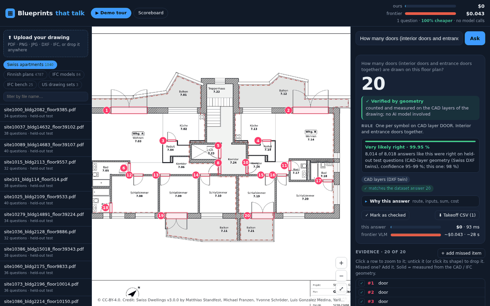 | 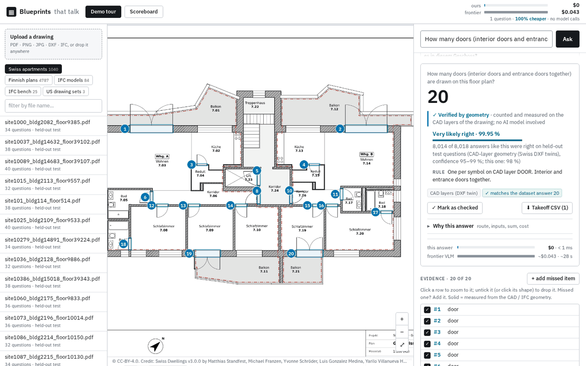 |
| room areas + frontier table, 1920 × 1080 | 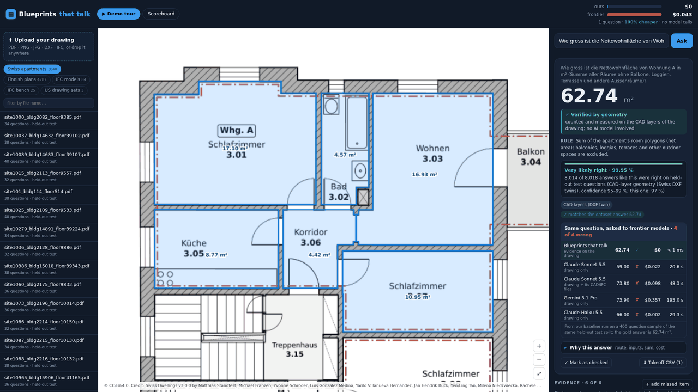 | 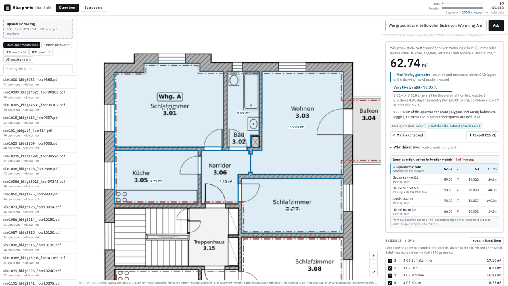 |
| model-read evidence + trace, 1920 × 1080 | 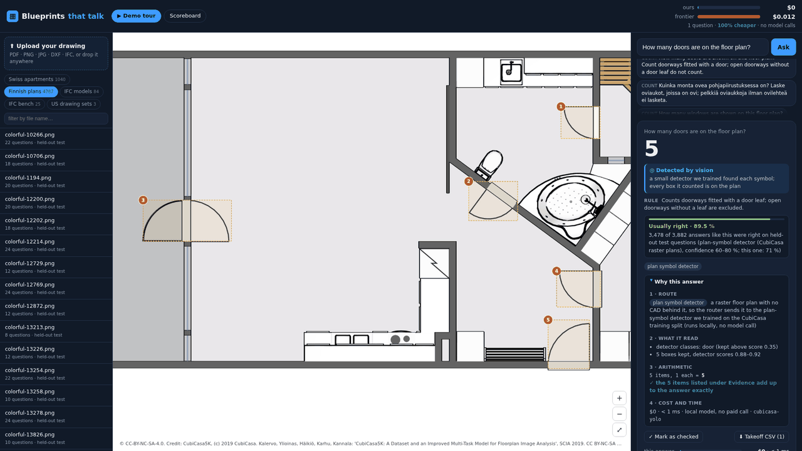 | 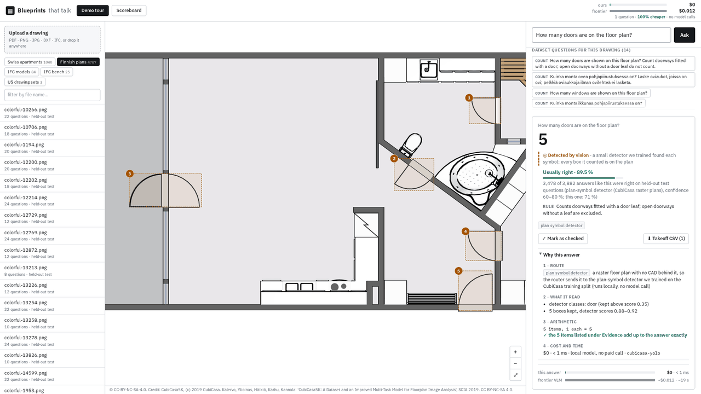 |
| demo tour caption | 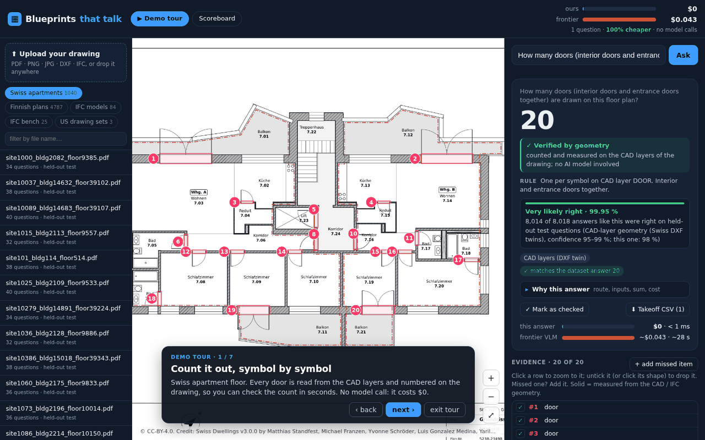 | 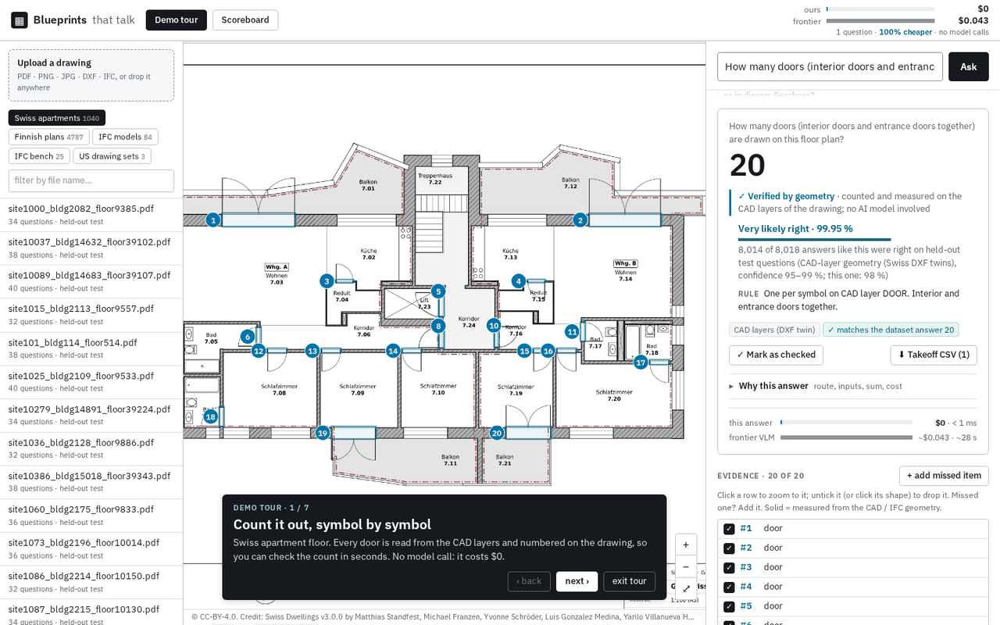 |
| phone, 390 × 844 | 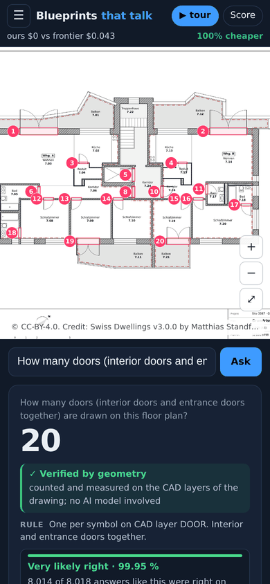 | 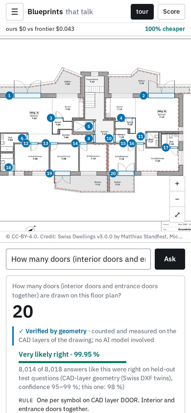 |
| scoreboard | 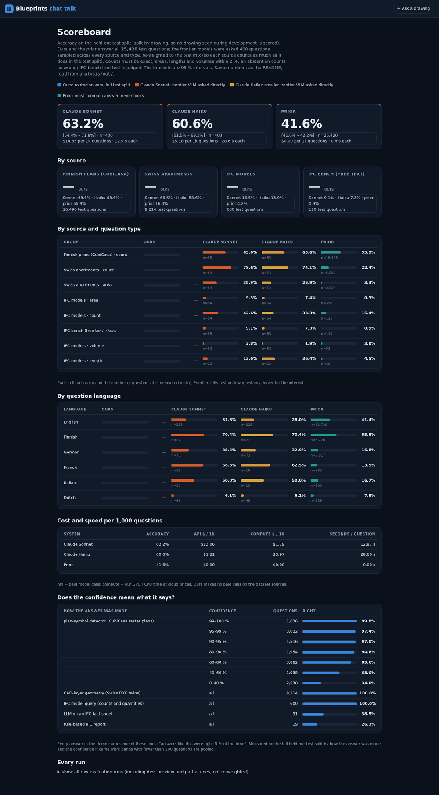 | 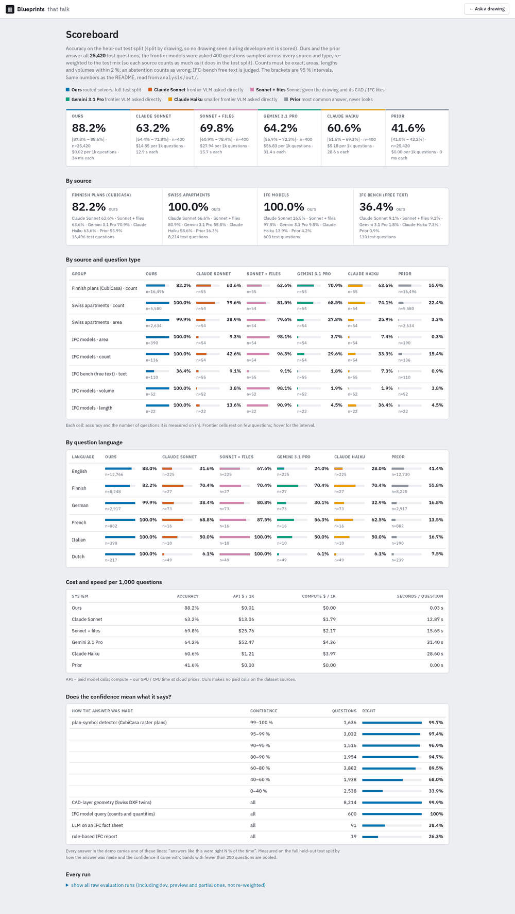 |

### Audit of the old design

- **Generic "AI tool" look.** It used a dark navy UI around a white drawing, a bright-blue pill CTA, a gradient
  intro card, a ✦ sparkle for LLM answers and rounded 14 px cards inside cards.
- **Low contrast.** Muted grey-blue text (`#8d9bb0` on `#111a28`) and 11 px grey footnotes were hard to read on a
  projector.
- **Clashing colours.** The pink-red evidence boxes collided with the red dash-dot apartment boundaries already
  printed on the Swiss plans. Pink was also the 3D highlight, while the polygons were blue. Green, blue, purple
  and amber "how" boxes each brought their own tinted background.
- **Inconsistent shapes.** There were 7 different radii (4 to 18 px), pills next to square buttons and an emoji
  arrow on the upload box.
- **Big number.** It was 52 px weight 800, competing with the drawing, and the unit floated apart from it.
- **Hard-to-scan list.** The evidence list had no right-aligned quantity column and no clear total rule.
- **Scoreboard bug.** Its "Ours" column was empty, because the run was renamed `router_full_test_v4`. It now
  picks the newest `router_full_test*` run, and Sonnet + files and Gemini were added.
