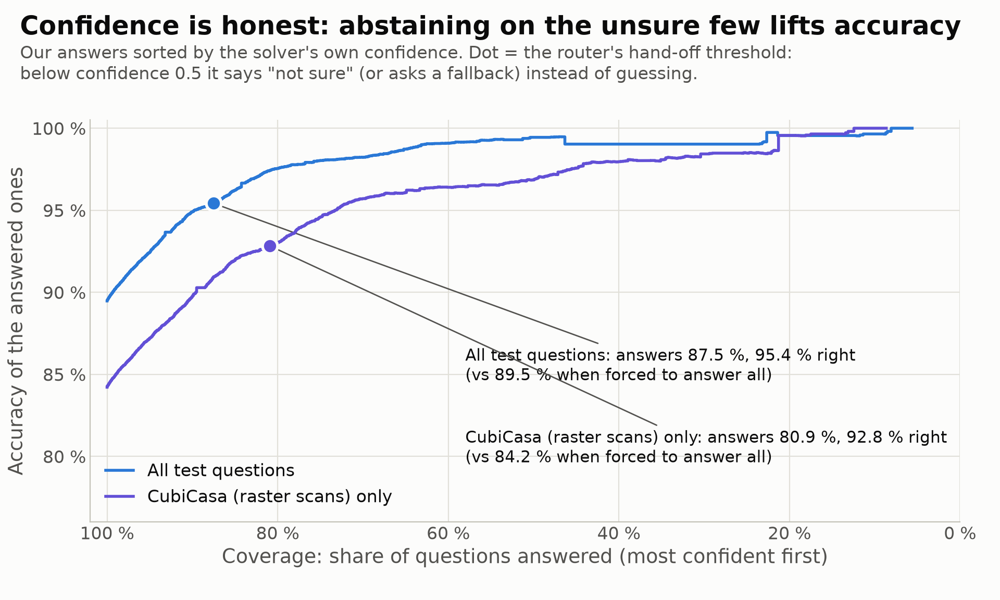

# Results

_Generated by `analysis/report.py` on 2026-11-13 from the run logs listed below. Re-run `analysis/run_all.sh` after new runs land; every number in this file comes from those logs._

## Headline

* **Ours (router): 88.2 %** on all 25,420 held-out test questions (95 % CI 87.8–88.6 %), **$0.01 API cost per 1,000 questions** (only the 110 free-text questions call a model; every numeric answer is $0), median answer in milliseconds.
* Claude Sonnet asked directly: **63.2 %** (CI 54.4–71.8 %, re-weighted to the test mix) at **$13.06 per 1,000 questions**.
* Claude Haiku asked directly: **60.6 %** (CI 51.5–69.3 %) at $1.21 per 1,000 questions.
* Guessing the most common dev-split answer for each question template (no drawing at all): 41.6 %.

## Where the numbers come from

| run file | system | rows | note |
|---|---|---|---|
| `runs/router_full_test_v4.jsonl` | Ours (router) | 25,420 | 19 text answer(s) judge-scored |
| `runs/baseline_sonnet_full400.jsonl` | Claude Sonnet, direct | 400 | 50 text answer(s) judge-scored |
| `runs/baseline_haiku_full400.jsonl` | Claude Haiku, direct | 400 | 38 text answer(s) judge-scored |
| `runs/baseline_gemini_full400.jsonl` | Gemini 3.1 Pro, direct | 400 | 1 text answer(s) judge-scored |
| `runs/baseline_sonnetfair_full400.jsonl` | Claude Sonnet + sibling CAD/IFC files | 400 | 50 text answer(s) judge-scored |
| `runs/prior_full_test.jsonl` | Template prior | 25,420 | 1 text answer(s) judge-scored |
| `runs/generic_cubicasa_300_haiku.jsonl` | Generic VLM pipeline (Haiku) | 300 |  |

* **Test split.** `bp/data.py` assigns each *drawing* (every format and language variant of it) to dev or test by hash, 20 % test. Nothing tuned on test drawings. The router run covers every test question (25,420).
* **Scoring** (`bp/score.py`): counts must be exact; area/length/volume within 2 %; abstentions count as wrong. Free-text answers (IFC bench, 110 test questions) are scored by the LLM judge in `bp/judge.py` (Haiku, fixed rubric, validated against hand labels) for **every** system, ours and the frontier baselines alike (`analysis/judge_runs.py` adds the baseline verdicts as `runs/<run>.judged.jsonl`). The token-F1 proxy in `eval.py` summaries is slightly different; both are listed in table 2.
* **Frontier baselines** answer a deterministic stratified sample of 400 test questions (`eval.py --sample 400`): about 55 per (source, type) group, all 52 volume and 22 length questions. A raw mean over that sample over-represents the rare IFC groups, so for the headline we **re-weight each group to its share of the full test split** and get the 95 % CI from a **stratified bootstrap** (10,000 resamples within each group, percentile interval). Full-split rates use the **Wilson** 95 % interval.
* **Cost.** Frontier cost = the API bill logged per question. Our solvers make no API calls; to put them on a log axis we price the logged wall-clock seconds at $0.50 per GPU-hour (a typical rental price for one consumer-class GPU). That overstates our cost: the sum of per-question wall-clock includes queueing behind parallel workers and covers CPU-only solvers too.

## 1. Accuracy vs cost per 1,000 questions


| system | n | accuracy [95 % CI] | CI method | API $/1k q | GPU-time $/1k q (est.) | mean s/q | answered |
|---|---|---|---|---|---|---|---|
| Ours (router) | 25,420 | 88.2 % [87.8, 88.6] | Wilson | $0.01 | – (in API price) | 0.03 s | 100 % |
| Claude Sonnet, direct | 400 | 63.2 % [54.4, 71.8] | re-weighted, stratified bootstrap | $13.06 | – (in API price) | 12.87 s | 99 % |
| Claude Haiku, direct | 400 | 60.6 % [51.5, 69.3] | re-weighted, stratified bootstrap | $1.21 | – (in API price) | 28.60 s | 96 % |
| Gemini 3.1 Pro, direct | 400 | 64.2 % [55.9, 72.3] | re-weighted, stratified bootstrap | $52.47 | – (in API price) | 31.40 s | 85 % |
| Claude Sonnet + sibling CAD/IFC files | 400 | 69.0 % [60.1, 77.6] | re-weighted, stratified bootstrap | $25.56 | – (in API price) | 15.57 s | 99 % |
| Template prior | 25,420 | 41.6 % [41.0, 42.2] | Wilson | $0.00 | $0.0000 | 0.00 s | 100 % |

Same questions, head to head (ours restricted to exactly the questions the baseline answered):

| baseline | n | ours raw | ours re-weighted [95 % CI] | baseline raw | both right | only ours right | only baseline right |
|---|---|---|---|---|---|---|---|
| Claude Sonnet, direct | 400 | 88.5 % | 85.6 % [78.5, 92.6] | 34.2 % | 131 | 223 | 6 |
| Claude Haiku, direct | 400 | 88.5 % | 85.6 % [78.5, 92.6] | 31.0 % | 118 | 236 | 6 |
| Gemini 3.1 Pro, direct | 400 | 88.5 % | 85.6 % [78.5, 92.6] | 28.0 % | 108 | 246 | 4 |
| Claude Sonnet + sibling CAD/IFC files | 400 | 88.5 % | 85.6 % [78.5, 92.6] | 66.2 % | 259 | 95 | 6 |

**Reading.** On the same 400 questions we are right on 223 that Claude Sonnet, direct misses, and it is right on only 6 that we miss. Re-weighted to the real test mix the frontier models look much better (63.2 %) than their raw sample mean (34.2 %), because CubiCasa counting, where they are strongest, is two thirds of the test split; we report the re-weighted number to be fair to them. Our own re-weighted score on the 400-question sample (85.6 %) is below our full-split 88.2 % because we got 43/55 of the sampled CubiCasa questions right (78.2 %, vs 80.8 % on all 16,496): 55 questions are a noisy estimate of a 16,496-question group, which is also why the frontier error bars are wide. The cost gap is about {son['api_usd_per_1k'] / max(ours['compute_usd_per_1k'], 1e-9):,.0f}x against Sonnet even after charging ourselves for GPU time.

## 2. Accuracy by source and question type


| source | type | Ours (router) | Claude Sonnet, direct | Claude Haiku, direct | Gemini 3.1 Pro, direct | Claude Sonnet + sibling CAD/IFC files | Template prior |
|---|---|---|---|---|---|---|---|
| CubiCasa | count | 82.2 % [81.6, 82.8] (n=16,496) | 63.6 % [50.4, 75.1] (n=55) | 63.6 % [50.4, 75.1] (n=55) | 70.9 % [57.9, 81.2] (n=55) | 63.6 % [50.4, 75.1] (n=55) | 55.9 % [55.1, 56.6] (n=16,496) |
| Swiss Dwellings | count | 100.0 % [99.9, 100.0] (n=5,580) | 79.6 % [67.1, 88.2] (n=54) | 74.1 % [61.1, 83.9] (n=54) | 68.5 % [55.3, 79.3] (n=54) | 81.5 % [69.2, 89.6] (n=54) | 22.4 % [21.3, 23.5] (n=5,580) |
| Swiss Dwellings | area | 99.9 % [99.7, 100.0] (n=2,634) | 38.9 % [27.0, 52.2] (n=54) | 25.9 % [16.1, 38.9] (n=54) | 27.8 % [17.6, 40.9] (n=54) | 79.6 % [67.1, 88.2] (n=54) | 3.3 % [2.7, 4.1] (n=2,634) |
| IFC models | area | 100.0 % [99.0, 100.0] (n=390) | 9.3 % [4.0, 19.9] (n=54) | 7.4 % [2.9, 17.6] (n=54) | 3.7 % [1.0, 12.5] (n=54) | 51.9 % [38.9, 64.6] (n=54) | 0.3 % [0.0, 1.4] (n=390) |
| IFC models | count | 100.0 % [97.3, 100.0] (n=136) | 42.6 % [30.3, 55.8] (n=54) | 33.3 % [22.2, 46.6] (n=54) | 29.6 % [19.1, 42.8] (n=54) | 90.7 % [80.1, 96.0] (n=54) | 15.4 % [10.3, 22.5] (n=136) |
| IFC bench | text | 36.4 % [28.0, 45.7] (n=110); token-F1 proxy 22.7 % | 9.1 % [3.9, 19.6] (n=55); token-F1 proxy 1.8 % | 7.3 % [2.9, 17.3] (n=55); token-F1 proxy 1.8 % | 1.8 % [0.3, 9.6] (n=55); token-F1 proxy 0.0 % | 9.1 % [3.9, 19.6] (n=55); token-F1 proxy 1.8 % | 0.9 % [0.2, 5.0] (n=110); token-F1 proxy 0.0 % |
| IFC models | volume | 100.0 % [93.1, 100.0] (n=52) | 3.8 % [1.1, 13.0] (n=52) | 1.9 % [0.3, 10.1] (n=52) | 1.9 % [0.3, 10.1] (n=52) | 82.7 % [70.3, 90.6] (n=52) | 3.8 % [1.1, 13.0] (n=52) |
| IFC models | length | 100.0 % [85.1, 100.0] (n=22) | 13.6 % [4.7, 33.3] (n=22) | 36.4 % [19.7, 57.0] (n=22) | 4.5 % [0.8, 21.8] (n=22) | 81.8 % [61.5, 92.7] (n=22) | 4.5 % [0.8, 21.8] (n=22) |

**Reading.** Everything with structured geometry is solved exactly: Swiss Dwellings counts and areas from the DXF, and IFC counts, areas, volumes and lengths from the model's quantities. The frontier models are weakest precisely there (IFC volumes and areas under 10 %): reading a 3D model or measuring an area from pixels is not something a chat model does reliably. Our two real weaknesses are visible too. CubiCasa raster counting is 82.2 %: better than any baseline, but one answer in five is wrong (section 4). Free-text IFC questions are 36.4 % with the LLM judge: our rule-based text answers cover the common question shapes (gross area, element types, MEP kinds) and say "not available" for the rest; the frontier models, reading raw IFC text, do worse still. With 110 questions the CI is wide.

## 3. Accuracy vs coverage (selective prediction)



Answer only when the solver's own confidence is at least t:

**All test questions** (n = 25,420, accuracy when forced to answer everything 88.2 %, area under the risk-coverage curve 0.020):

| threshold t | coverage | answered | accuracy of answered | wrong answers kept | wrong answers turned into "not sure" |
|---|---|---|---|---|---|
| 0.5 (router) | 86.0 % | 21,862 | 95.5 % | 977 | 2,027 |
| 0.7 | 77.4 % | 19,677 | 97.7 % | 447 | 2,557 |
| 0.9 | 58.8 % | 14,956 | 99.1 % | 132 | 2,872 |
| 0.95 | 52.1 % | 13,232 | 99.4 % | 86 | 2,918 |
| 0.99 | 6.4 % | 1,636 | 99.8 % | 4 | 3,000 |

**CubiCasa only** (n = 16,496, accuracy when forced to answer everything 82.2 %, area under the risk-coverage curve 0.044):

| threshold t | coverage | answered | accuracy of answered | wrong answers kept | wrong answers turned into "not sure" |
|---|---|---|---|---|---|
| 0.5 (router) | 78.5 % | 12,954 | 92.9 % | 916 | 2,014 |
| 0.7 | 65.8 % | 10,862 | 95.9 % | 442 | 2,488 |
| 0.9 | 37.5 % | 6,184 | 97.9 % | 128 | 2,802 |
| 0.95 | 28.3 % | 4,668 | 98.2 % | 82 | 2,848 |
| 0.99 | 9.9 % | 1,636 | 99.8 % | 4 | 2,926 |

Calibration: accuracy per confidence bin (Wilson 95 % CI).

| subset | confidence | n | mean confidence | accuracy [95 % CI] | share of answers that are 0 |
|---|---|---|---|---|---|
| all | 0–0.5 | 3,558 | 0.31 | 43.0 % [41.4, 44.7] | 12 % |
| all | 0.5–0.7 | 2,185 | 0.61 | 75.7 % [73.9, 77.5] | 3 % |
| all | 0.7–0.9 | 4,721 | 0.79 | 93.3 % [92.6, 94.0] | 7 % |
| all | 0.9–0.95 | 1,724 | 0.93 | 97.3 % [96.5, 98.0] | 33 % |
| all | 0.95–0.99 | 11,596 | 0.97 | 99.3 % [99.1, 99.4] | 9 % |
| all | 0.99–1.0 | 1,636 | 1.00 | 99.8 % [99.4, 99.9] | 0 % |
| cubicasa | 0–0.5 | 3,542 | 0.31 | 43.1 % [41.5, 44.8] | 12 % |
| cubicasa | 0.5–0.7 | 2,092 | 0.61 | 77.3 % [75.5, 79.1] | 3 % |
| cubicasa | 0.7–0.9 | 4,678 | 0.79 | 93.3 % [92.5, 94.0] | 7 % |
| cubicasa | 0.9–0.95 | 1,516 | 0.93 | 97.0 % [96.0, 97.7] | 37 % |
| cubicasa | 0.95–0.99 | 3,032 | 0.98 | 97.4 % [96.8, 97.9] | 30 % |
| cubicasa | 0.99–1.0 | 1,636 | 1.00 | 99.8 % [99.4, 99.9] | 0 % |

**Reading.** The confidence is useful: at the router's threshold (0.5) we answer 86 % of all questions at 95.5 % and say "not sure" on the rest, which turns 2,027 wrong answers into honest abstentions at the price of 1,531 right ones. On CubiCasa the same threshold keeps 79 % at 92.9 % (vs 82.2 %). Below 0.95 the bins are roughly calibrated (stated confidence within about ten points of observed accuracy). **The weak spot is the very top:** answers with confidence ≥ 0.99 (all of them CubiCasa) are right 99.8 % of the time while claiming 0.997, below the 0.95–0.99 bin (99.3 %, mostly Swiss and IFC); that is why the blue curve falls again at the low-coverage (right) end. 0 of the 4 wrong top-confidence CubiCasa answers are a confident **0**: the detector saw nothing even near its threshold, so the confidence formula (which only looks at detections near the threshold) has nothing to doubt. A symbol the detector misses entirely cannot lower its confidence; that is the failure mode to fix next (e.g. a prior on "0" for rooms that almost every plan has). The published 87.2 % is the forced-answer number; the router's Sonnet/Haiku fallback below the threshold is off in this run.

## 4. CubiCasa per question template


| template | mean true count | Ours (router) | Claude Sonnet, direct | Claude Haiku, direct | Gemini 3.1 Pro, direct | Claude Sonnet + sibling CAD/IFC files | Generic VLM pipeline (Haiku) | Template prior | ours: too low | ours: too high | ours: mean error |
|---|---|---|---|---|---|---|---|---|---|---|---|
| Windows | 8.7 | 45 % (n=1,844) | 10 % (n=10) | 20 % (n=10) | 0 % (n=10) | 10 % (n=10) | 19 % (n=32) | 16 % (n=1,844) | 26 % | 29 % | -0.14 |
| Doors | 8.6 | 72 % (n=1,326) | 0 % (n=1) | 100 % (n=1) | 0 % (n=1) | 0 % (n=1) | 41 % (n=17) | 12 % (n=1,326) | 13 % | 15 % | +0.04 |
| Toilets | 1.4 | 90 % (n=1,840) | 89 % (n=9) | 89 % (n=9) | 89 % (n=9) | 89 % (n=9) | 83 % (n=47) | 62 % (n=1,840) | 6 % | 4 % | -0.04 |
| Sinks | 2.6 | 82 % (n=1,812) | 67 % (n=6) | 67 % (n=6) | 83 % (n=6) | 67 % (n=6) | 23 % (n=30) | 52 % (n=1,812) | 9 % | 9 % | -0.03 |
| Showers + baths | 1.2 | 76 % (n=1,710) | 0 % (n=2) | 0 % (n=2) | 50 % (n=2) | 0 % (n=2) | 43 % (n=30) | 76 % (n=1,710) | 12 % | 11 % | -0.04 |
| Saunas | 0.6 | 93 % (n=1,298) | 83 % (n=6) | 100 % (n=6) | 100 % (n=6) | 83 % (n=6) | 44 % (n=25) | 56 % (n=1,298) | 2 % | 5 % | +0.03 |
| Kitchens | 1.0 | 97 % (n=1,274) | 75 % (n=4) | 50 % (n=4) | 100 % (n=4) | 75 % (n=4) | 75 % (n=20) | 97 % (n=1,274) | 2 % | 1 % | -0.00 |
| Bedrooms | 1.6 | 86 % (n=1,162) | 50 % (n=2) | 0 % (n=2) | 50 % (n=2) | 50 % (n=2) | 79 % (n=19) | 30 % (n=1,162) | 7 % | 7 % | +0.02 |
| WC rooms | 0.5 | 93 % (n=906) | 75 % (n=4) | 75 % (n=4) | 100 % (n=4) | 75 % (n=4) | 48 % (n=21) | 57 % (n=906) | 6 % | 1 % | -0.05 |
| Bathrooms | 1.0 | 86 % (n=916) | 80 % (n=5) | 60 % (n=5) | 80 % (n=5) | 80 % (n=5) | 83 % (n=12) | 88 % (n=916) | 9 % | 4 % | -0.06 |
| Balconies | 0.5 | 82 % (n=564) | 100 % (n=2) | 100 % (n=2) | 100 % (n=2) | 100 % (n=2) | 62 % (n=13) | 50 % (n=564) | 16 % | 2 % | -0.15 |
| Floors | 1.2 | 98 % (n=1,844) | 100 % (n=4) | 100 % (n=4) | 100 % (n=4) | 100 % (n=4) | 24 % (n=34) | 80 % (n=1,844) | 1 % | 1 % | +0.00 |

Signed error of our CubiCasa answers (predicted − true; ends clipped at ±5):

| error | ≤-5 | -4 | -3 | -2 | -1 | +0 | +1 | +2 | +3 | +4 | ≥+5 |
|---|---|---|---|---|---|---|---|---|---|---|---|
| share | 0.5 % | 0.4 % | 0.7 % | 1.5 % | 6.1 % | 82.2 % | 5.9 % | 1.5 % | 0.6 % | 0.2 % | 0.4 % |

**Reading.** The detector is strong on symbols with a fixed shape (toilets, sauna stoves) and on typed rooms (WC rooms 93 %, bedrooms 86 %), and counts storeys almost perfectly (98 %). **Windows are the weak template** (45 % exact, true count averages 8.7): exact counting of eight-plus thin wall symbols is unforgiving, and our misses are mostly under-counts (26 % too low vs 29 % too high). Doors and sinks lean the other way (over-counting; plausibly double doors and double basins detected as two). **Honest caveat:** a constant guess from the dev split matches or beats us on bathrooms (88 % vs our 86 %): nearly every plan has exactly one kitchen and one bathroom, so the detector's occasional extra or missed room costs more than the prior's rare miss. Falling back to the prior when the detector is unsure would close that gap. Overall, when a count is wrong it is usually off by one (11.9 % of all questions), which the numbered evidence boxes make easy for a human to spot. Frontier per-template numbers rest on 1–10 questions each (the 400-question sample has 55 CubiCasa questions); the generic VLM pipeline run gives 12–47 per template and is the better comparison.

## 5. By question language


| language | Ours (router) | Claude Sonnet, direct | Claude Haiku, direct | Gemini 3.1 Pro, direct | Claude Sonnet + sibling CAD/IFC files | sources of our questions in this language |
|---|---|---|---|---|---|---|
| en | 88.0 % [87.4, 88.5] (n=12,766) | 31.6 % [25.8, 37.9] (n=225) | 28.0 % [22.5, 34.2] (n=225) | 24.0 % [18.9, 30.0] (n=225) | 60.0 % [53.5, 66.2] (n=225) | cubicasa5k 8248; swiss_dwellings 4107; ifc_models 301; ifc_bench 110 |
| fi | 82.2 % [81.4, 83.0] (n=8,248) | 70.4 % [51.5, 84.1] (n=27) | 70.4 % [51.5, 84.1] (n=27) | 70.4 % [51.5, 84.1] (n=27) | 70.4 % [51.5, 84.1] (n=27) | cubicasa5k 8248 |
| de | 99.9 % [99.8, 100.0] (n=2,917) | 38.4 % [28.1, 49.8] (n=73) | 32.9 % [23.2, 44.3] (n=73) | 30.1 % [20.8, 41.4] (n=73) | 80.8 % [70.3, 88.2] (n=73) | swiss_dwellings 2839; ifc_models 78 |
| fr | 100.0 % [99.6, 100.0] (n=882) | 68.8 % [44.4, 85.8] (n=16) | 62.5 % [38.6, 81.5] (n=16) | 56.2 % [33.2, 76.9] (n=16) | 87.5 % [64.0, 96.5] (n=16) | swiss_dwellings 882 |
| it | 100.0 % [99.0, 100.0] (n=390) | 50.0 % [23.7, 76.3] (n=10) | 50.0 % [23.7, 76.3] (n=10) | 50.0 % [23.7, 76.3] (n=10) | 100.0 % [72.2, 100.0] (n=10) | swiss_dwellings 386; ifc_models 4 |
| nl | 100.0 % [98.3, 100.0] (n=217) | 6.1 % [2.1, 16.5] (n=49) | 6.1 % [2.1, 16.5] (n=49) | 6.1 % [2.1, 16.5] (n=49) | 57.1 % [43.3, 70.0] (n=49) | ifc_models 217 |

**Reading.** Language is detected from the question text (`langdetect`). The test split holds English, Finnish, German, French, Italian and Dutch questions; there are no Estonian or Danish questions in it. Our solvers parse the question template in either language, so language itself changes nothing: all 8,248 Finnish/English CubiCasa twins (same drawing, same question) get the same answer (8,248 identical). The per-language gaps are a source mix effect: every Finnish question is a CubiCasa raster count (our hardest source), while German/French/Italian questions come from Swiss Dwellings and IFC models, which we solve exactly. The frontier per-language numbers are raw sample means (not re-weighted) with n = 10–225 and carry the same confound.

## 6. Latency per solver


| run | solver | n | median | p90 | p99 | mean | max |
|---|---|---|---|---|---|---|---|
| Ours (router) | Swiss DXF geometry | 8,214 | 0.001 s | 0.019 s | 0.059 s | 0.007 s | 0.52 s |
| Ours (router) | IFC geometry / quantities | 691 | 0.024 s | 0.122 s | 7.009 s | 0.244 s | 7.91 s |
| Ours (router) | CubiCasa detector | 16,496 | 0.025 s | 0.086 s | 0.162 s | 0.038 s | 3.63 s |
| Ours (router) | Swiss DXF geometry · slowest per drawing | 228 | 0.040 s | 0.074 s | 0.130 s | 0.042 s | 0.52 s |
| Ours (router) | IFC geometry / quantities · slowest per drawing | 24 | 0.068 s | 0.519 s | 7.649 s | 0.706 s | 7.91 s |
| Ours (router) | CubiCasa detector · slowest per drawing | 922 | 0.082 s | 0.140 s | 0.292 s | 0.095 s | 3.63 s |
| Ours (router) | IFC text (rules) | 19 | 0.103 s | 0.582 s | 0.732 s | 0.181 s | 0.73 s |
| Ours (router) | IFC text (rules) · slowest per drawing | 4 | 0.417 s | 0.731 s | 0.734 s | 0.413 s | 0.73 s |
| Claude Sonnet + sibling CAD/IFC files | Claude Sonnet, direct | 400 | 11.910 s | 45.324 s | 96.667 s | 18.981 s | 164.94 s |
| Claude Sonnet, direct | Claude Sonnet, direct | 400 | 14.964 s | 27.354 s | 58.746 s | 17.152 s | 71.10 s |
| Gemini 3.1 Pro, direct | gemini-3.1-pro-preview | 400 | 18.729 s | 149.099 s | 213.048 s | 47.670 s | 385.11 s |
| Generic VLM pipeline (Haiku) | Generic VLM pipeline (Haiku) | 300 | 28.285 s | 80.784 s | 378.710 s | 48.391 s | 654.91 s |
| Claude Haiku, direct | Claude Haiku, direct | 400 | 29.194 s | 60.794 s | 119.097 s | 34.944 s | 140.40 s |

**Reading.** Wall-clock per question as logged by `eval.py` (rounded to 1 ms, so many Swiss answers log as 0). Questions about the same drawing share one detector pass (in-memory cache), so the median question is nearly free and the *slowest question per drawing* is the honest cold-path figure: about 0.1 s for a CubiCasa plan on the RTX 4070 laptop GPU, including the parallel workers queueing for the one model. The ~4 s maximum is the detector loading at start-up. IFC text answers are slower (median 0.2 s) because they walk the whole model. Frontier answers take 15–30 s median, with multi-minute tails for the agentic generic pipeline.

## Reproduce

```bash
.venv/bin/python eval.py --solver router --split test --name router_full_test --jobs 8   # ours
.venv/bin/python eval.py --solver prior --split test --name prior_full_test                # prior
analysis/run_all.sh   # judge baseline text answers (cached), tables, figures, this file
```

Machine-readable tables: `analysis/out/*.csv`, `analysis/out/numbers.json`.
